<div align="center">

# 🛍️ Smomo Dashboard

### Enterprise-Grade E-Commerce Management & Storefront Platform

[](https://nextjs.org/)
[](https://react.dev/)
[](https://www.typescriptlang.org/)
[](https://tailwindcss.com/)
[](https://www.prisma.io/)
[](https://www.sqlite.org/)

**لوحة تحكم إدارية متطورة وشاملة للتجارة الإلكترونية مع محرك تخصيص قوالب حي، إدارة مخزون متقدمة، نظام استرجاع السلال المهجورة، ومسارات مبيعات تفاعلية.**

[المميزات](#-features) • [معرض الصور](#-screenshots--ui-showcase) • [هيكل قاعدة البيانات](#-database-architecture) • [دليل التثبيت والتشغيل](#-quick-start) • [واجهات برمجة التطبيقات](#-api-endpoints)

</div>

---

## 🌟 Highlights & Architecture

**Smomo Platform** is a state-of-the-art e-commerce administrative suite crafted with **Next.js 16 (App Router & Turbopack)**, **React 19**, **Prisma ORM**, and **Tailwind CSS v4**. It bridges an administrative back-office with an optimized, bilingual (RTL/LTR) customer storefront.

```
SmomoPlatform/
├── 🏢 admin-backend/ (Port 3000)
│   ├── 🏬 Online Store Engine (Theme Customizer, Menus, Languages, Pages)
│   ├── 📦 Inventory Management & Stock Reconciliation Audits
│   ├── 🛒 Abandoned Carts & Automated Email Recovery
│   ├── 📋 Order Processing & Customer Management
│   ├── 📊 Interactive Analytics & Insights
│   └── ⚡ RESTful Backend APIs & Server Actions (/api/*)
├── 🛍️ storefront/ (Port 3001)
│   ├── 🏷️ Dynamic Product Catalog with Category Filtering
│   ├── 🔍 High-Definition Product Details (Zoom Lens, Color & Variant Selector)
│   ├── 🛒 Zustand Cart State Management & Instant Side Drawer
│   └── 💳 High-Conversion Responsive Guest Checkout
└── 🗄️ prisma/ (Shared Database Model)
    ├── schema.prisma (Single source of truth with Decimal pricing)
    └── seed-*.js (Realistic demo data seeders)
```

---

## 📸 Screenshots & UI Showcase

### 🏬 1. Theme Customizer & Storefront Visual Engine (`/admin/store/theme`)

A modular theme editor giving store owners complete visual control over layout, typography, colors, banners, and product pages.

|            Homepage Slider & Product Sections             |                      Custom Checkout Designer                      |
| :-------------------------------------------------------: | :----------------------------------------------------------------: |
| 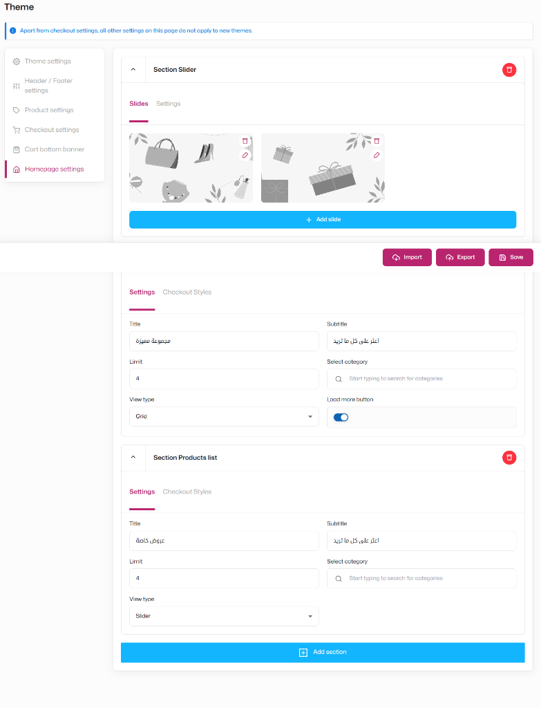 | 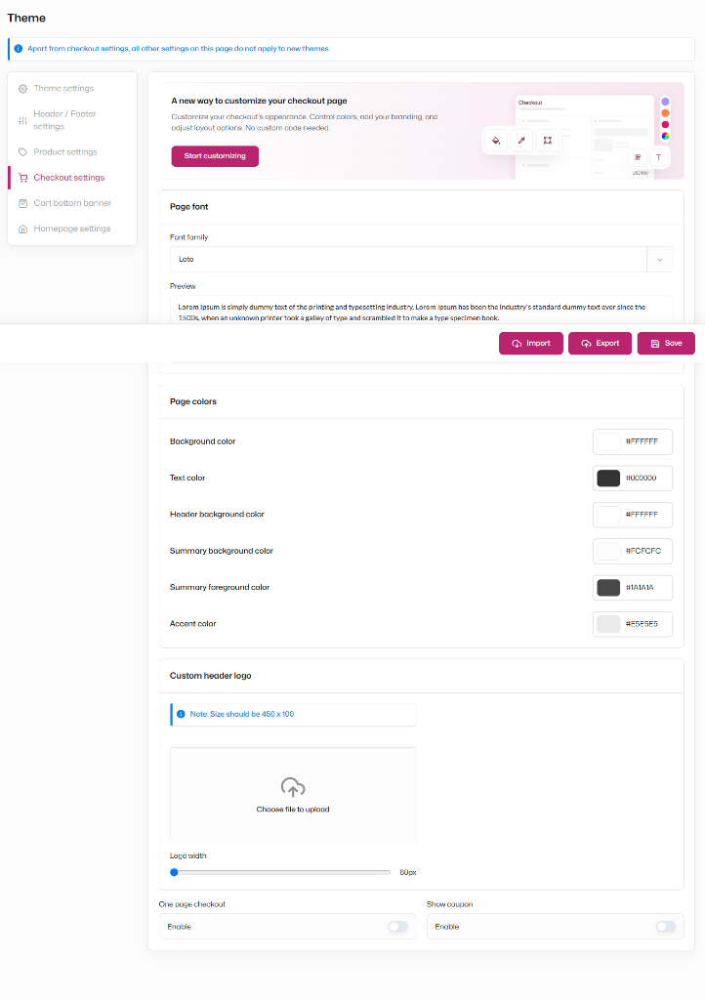 |

|                   Product Page Section Toggles                   |                  Mobile Header & Navigation Layout                  |
| :--------------------------------------------------------------: | :-----------------------------------------------------------------: |
| 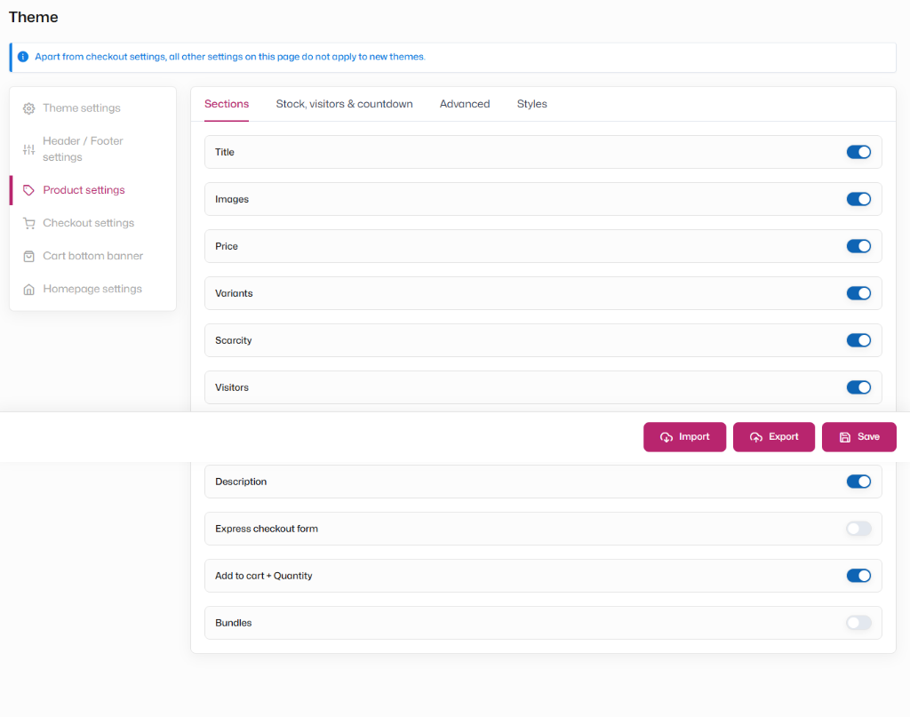 | 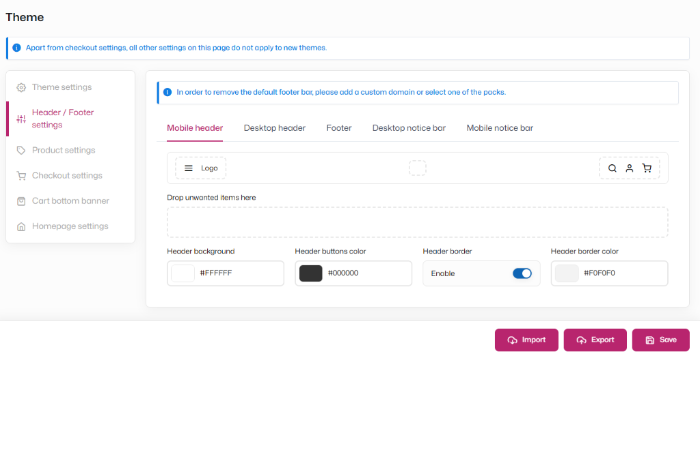 |

|             Promotional Cart Bottom Banner Upload             |
| :-----------------------------------------------------------: |
| 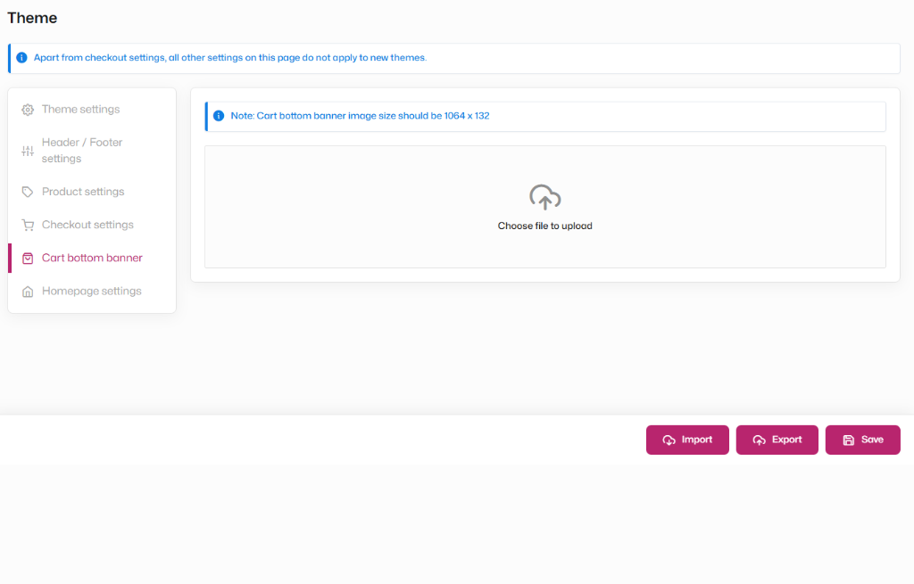 |

---

### 📦 2. Real-Time Inventory & Reconciliation Audits (`/admin/products/inventory`)

Monitor live warehouse levels, auto-calculate stock health statuses, adjust units with one click, and perform physical count audits.

|                   Current Stock Table & Metrics                    |             Stock Discrepancy Audits (`REV-001`)             |
| :----------------------------------------------------------------: | :----------------------------------------------------------: |
| 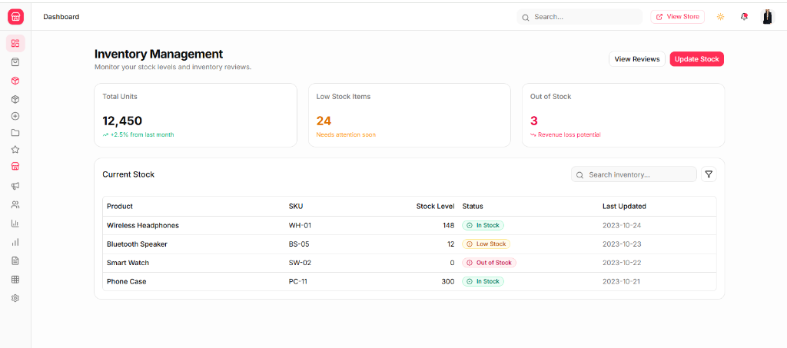 | 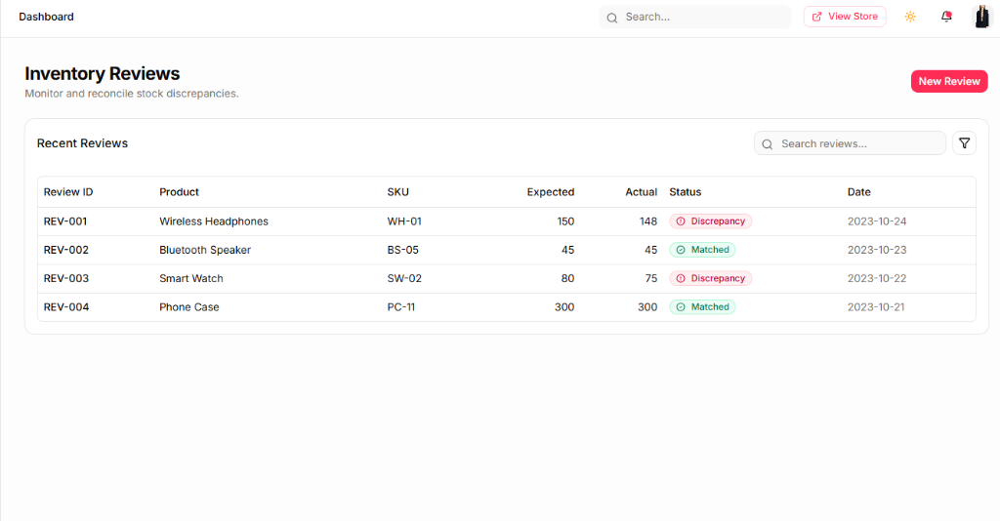 |

---

### 🛒 3. Abandoned Carts & Order Processing

Track lost revenues, trigger automated recovery emails with custom discount coupons, and manage order lifecycles.

|                 Abandoned Carts Tracking                 |                  Orders Management Workflow                  |
| :------------------------------------------------------: | :----------------------------------------------------------: |
| 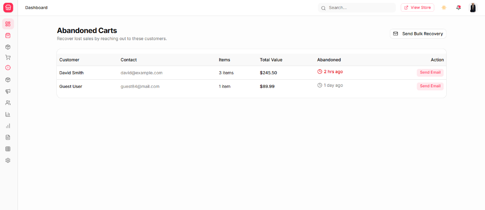 | 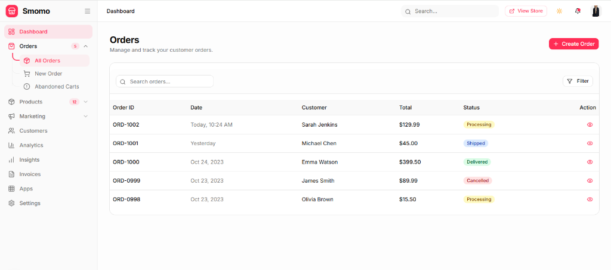 |

---

### 🛍️ 4. Storefront & Product Details Experience (`/store/products/[id]`)

Interactive buyer experience featuring zoom lenses, color switching, stock countdowns, and real-time reviews.

|           Product Detail Gallery & Customer Reviews            |                Product Reviews Moderation                |
| :------------------------------------------------------------: | :------------------------------------------------------: |
| 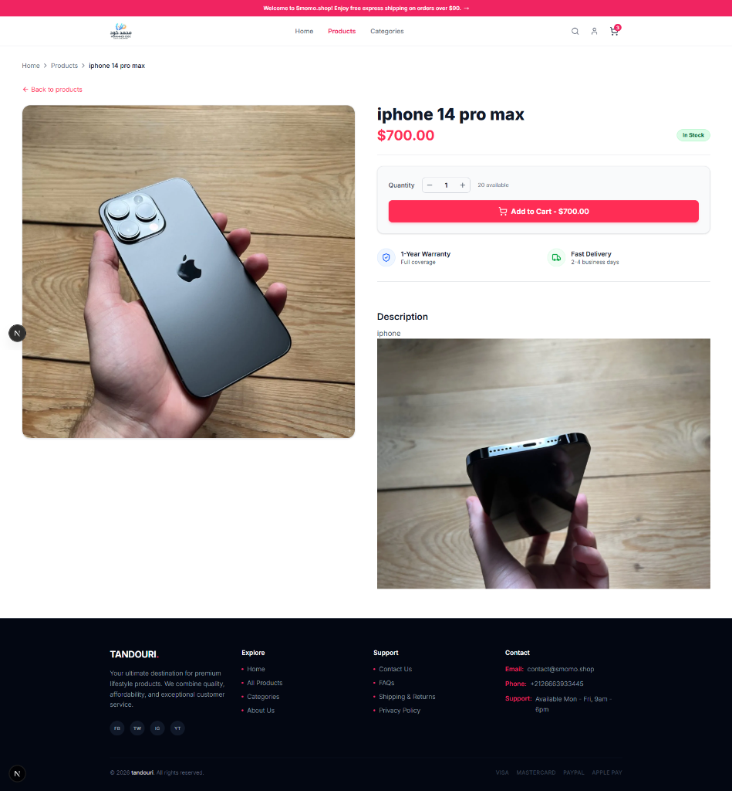 | 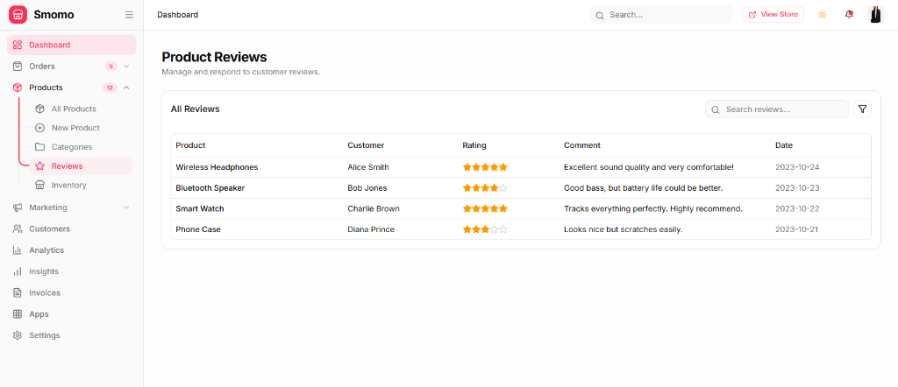 |

---

## ✨ Features

### 🏬 1. Online Store Engine (`/admin/store/*`)

- **Store Overview (`/admin/store`)**: Live store status, device preview toggles (Mobile / Desktop), and quick jump navigation cards.
- **Theme Customizer (`/admin/store/theme`)**:
  - **Homepage Builder**: Accordion-based slider manager with drag-and-drop slide ordering, grid/slider product lists with custom titles, categories, and load-more controls.
  - **Header & Footer**: Mobile navbar visual mockups, drag-to-hide unused items, color pickers, sticky options, and border switches.
  - **Product Page Settings**: Toggle switches for Price, Variants, Scarcity triggers, Visitor counters, Express forms, and Bundles.
  - **Checkout Designer**: Font picker (Lato, Cairo, Inter, Roboto), hex color controls, custom header logo slider, and one-page checkout switches.
  - **Cart Bottom Banner**: $1064 \times 132$ drag-and-drop banner upload area with instant preview.
  - **Import / Export / Save**: Fixed bottom action bar allowing one-click configuration JSON export and live database persistence.
- **Themes Library (`/admin/store/themes`)**: Switch between themes (_Smomo Modern_, _Minimalist Boutique_, _Dark Tech_, _Bold Retailer_), live preview, and ZIP package upload.
- **Menus Editor (`/admin/store/menus`)**: Manage Header Navigation and Footer links with reordering, quick URLs, and addition modals.
- **Languages & Localization (`/admin/store/languages`)**: Multi-language management (Arabic RTL, English LTR, French LTR) with default selector and translation percentage indicators.
- **Static Pages CMS (`/admin/store/pages`)**: Publish About Us, Privacy Policy, Terms, and FAQs with SEO-friendly slugs and draft/published statuses.
- **Sales Funnels (`/admin/store/funnels`)**: Build high-converting one-product sales funnels with visual flow steps (Landing $\rightarrow$ Checkout $\rightarrow$ Upsell $\rightarrow$ Thank You).

### 📦 2. Inventory Management & Audits

- **Live Inventory Calculation**: Real-time sum of total warehouse units ($12,450$), Low Stock items ($\le 20$), and Out of Stock alerts ($0$).
- **Color-Coded Status Badges**:
  - `In Stock`: Emerald green badge with `CheckCircle2` icon.
  - `Low Stock`: Amber badge with `AlertCircle` icon.
  - `Out of Stock`: Crimson red badge with `AlertCircle` icon.
- **Instant Stock Update Modal**: Adjust units, add quick offsets ($+50$, $+100$), or set to zero with auto status recalculation.
- **Physical Reconciliation Audits (`/admin/products/inventory/reviews`)**: Compare `Expected` vs `Actual` counts, generate `REV-XXX` audit codes, and flag `Matched` or `Discrepancy` outcomes.

### 🛒 3. Abandoned Carts Recovery

- **Lost Revenue Recovery**: Calculate total at-risk revenue and track recovery conversions.
- **Email Incentives**: Simulated automated SMTP/Resend email dispatch with personalized discount vouchers (e.g. `COMEBACK15`).
- **Cart Lifecycle Tracking**: Status transitions (`ABANDONED` $\rightarrow$ `EMAIL_SENT` $\rightarrow$ `RECOVERED`).

---

## 🗄️ Database Architecture

Built with **Prisma ORM** over SQLite (`prisma/dev.db`):

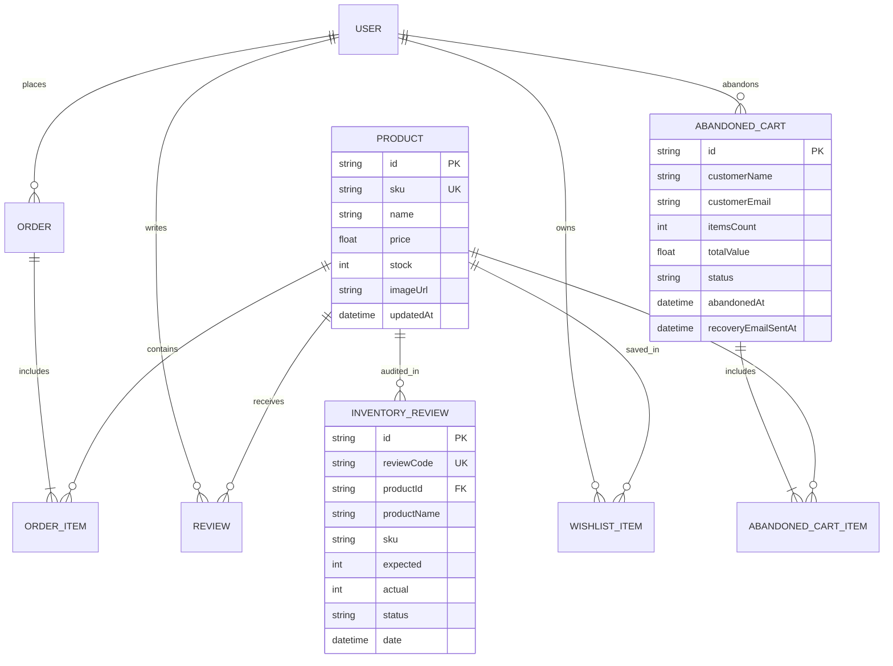

---

## 🚀 Quick Start

### 1. Prerequisites

- **Node.js**: `v20.x` or higher
- **npm** or **pnpm**

### 2. Installation & Setup

Clone the repository and install packages:

```bash
git clone https://github.com/mohamedtandouri/smomodashboard.git
cd smomodashboard
npm install
```

### 3. Initialize Database & Seed Data

Push the Prisma schema to the local SQLite database and populate realistic initial data:

```bash
# Push database schema
npx prisma db push

# Seed database with products, reviews, inventory, and carts
node prisma/seed-inventory.js
node prisma/seed-abandoned-carts.js
node prisma/seed-reviews.js
```

### 4. Run Development Servers

The platform is decoupled into two independent applications. You can run them individually or concurrently:

* **Customer Storefront (`http://localhost:3001/store`):**
  ```bash
  npm run dev:storefront
  ```
  *(or navigate into `cd storefront` and run `npm run dev`)*

* **Admin Dashboard & API (`http://localhost:3000/admin`):**
  ```bash
  npm run dev:admin
  ```
  *(or navigate into `cd admin-backend` and run `npm run dev`)*

### 5. Run via Docker Compose (Full Stack)

To run everything (PostgreSQL 15, Redis 7, Admin Backend, and Storefront) in containerized production mode:

```bash
docker compose up -d --build
```
- **Admin**: `http://localhost:3000/admin`
- **Storefront**: `http://localhost:3001/store`

---

## 🔌 API Endpoints

### Store & Theme

| Method | Endpoint           | Description                                                 |
| :----- | :----------------- | :---------------------------------------------------------- |
| `GET`  | `/api/store/theme` | Retrieve active theme settings (header, checkout, homepage) |
| `POST` | `/api/store/theme` | Save, reset, or import theme configuration payload          |

### Inventory & Stock

| Method   | Endpoint                      | Description                                             |
| :------- | :---------------------------- | :------------------------------------------------------ |
| `GET`    | `/api/inventory`              | Real-time stock counts, status health, and product list |
| `PUT`    | `/api/products/[id]`          | Update product stock units, SKU, and metadata           |
| `GET`    | `/api/inventory/reviews`      | Fetch inventory reconciliation records with search      |
| `POST`   | `/api/inventory/reviews`      | Create audit record with auto-discrepancy detection     |
| `DELETE` | `/api/inventory/reviews/[id]` | Remove audit report                                     |

### Abandoned Carts

| Method   | Endpoint                          | Description                                           |
| :------- | :-------------------------------- | :---------------------------------------------------- |
| `GET`    | `/api/abandoned-carts`            | List abandoned carts with search and revenue metrics  |
| `POST`   | `/api/abandoned-carts/send-email` | Dispatch recovery coupon email and update cart status |
| `PATCH`  | `/api/abandoned-carts/[id]`       | Edit cart notes or customer details                   |
| `DELETE` | `/api/abandoned-carts/[id]`       | Delete cart record                                    |

---

## 🛠️ Tech Stack

- **Framework**: [Next.js 16](https://nextjs.org/) (App Router, Server Components & Route Handlers)
- **UI & Components**: [React 19](https://react.dev/), [Shadcn UI](https://ui.shadcn.com/), [Base UI](https://base-ui.com/)
- **Styling**: [Tailwind CSS v4](https://tailwindcss.com/)
- **Icons**: [Lucide React](https://lucide.dev/)
- **Animations**: [Framer Motion](https://www.framer.com/motion/)
- **ORM & DB**: [Prisma](https://www.prisma.io/) & [SQLite](https://www.sqlite.org/)
- **Rich Text & Forms**: [TipTap](https://tiptap.dev/), [React Hook Form](https://react-hook-form.com/), [Zod](https://zod.dev/)

---

## 📄 License

This project is licensed under the [MIT License](LICENSE).

<div align="center">
  <sub>Built with ❤️ by Mohamed Tandouri for modern e-commerce brands.</sub>
</div>
