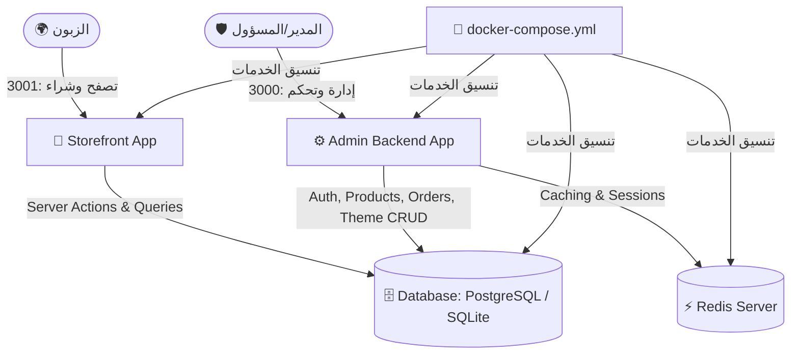

# 🛍️ الدليل الشامل لتوثيق منصة Smomo (E-Commerce Platform)

منصة **Smomo** هي حل متكامل ومتقدم للتجارة الإلكترونية مبني بأحدث تقنيات الويب الحديثة (**Next.js 16** مع محرك **Turbopack**، **React 19**، **Tailwind CSS v4**، و **Prisma ORM**). تعتمد المنصة على معمارية مفصولة حديثة (**Decoupled / Headless Architecture**) تفصل بين لوحة تحكم الإدارة ومتجر العملاء مع قاعدة بيانات موحدة وأمان سيبراني مشدد.

---

## 📑 فهرس المحتويات
1. [نظرة عامة والمعمارية العامة](#1-نظرة-عامة-والمعمارية-العامة)
2. [حزمة التقنيات (Tech Stack)](#2-حزمة-التقنيات-tech-stack)
3. [بنية المجلدات والملفات (Directory Structure)](#3-بنية-المجلدات-والملفات)
4. [قاعدة البيانات والمخطط (Database Schema)](#4-قاعدة-البيانات-والمخطط)
5. [لوحة التحكم الإدارية (Admin Backend)](#5-لوحة-التحكم-الإدارية-admin-backend)
6. [متجر الزبائن (Storefront)](#6-متجر-الزبائن-storefront)
7. [التحصينات الأمنية (Security Hardening)](#7-التحصينات-الأمنية)
8. [دليل التثبيت والتشغيل المحلي (Local Quick Start)](#8-دليل-التثبيت-والتشغيل-المحلي)
9. [دليل النشر بالحاويات (Docker & Production Deployment)](#9-دليل-النشر-بالحاويات-docker)
10. [واجهات البرمجة والعمليات (API & Server Actions)](#10-واجهات-البرمجة-والعمليات)

---

## 1. نظرة عامة والمعمارية العامة

تمت ترقية المشروع وإعادة هيكلته من نمط كود متداخل (Monolith) إلى نمط مفصول الخدمات لضمان أعلى معايير الأمان، الاستقرار، وقابلية التوسع:



### المميزات المعمارية:
* **الفصل التام للواجهات:** الزبون العادي لا يستطيع الوصول لأي كود أو مسار إداري.
* **الأمان المشدد:** منع الوصول غير المصرح به للـ Admin بشكل برمجي حتمي (`auth-guard.ts`).
* **الدقة المالية:** استخدام `Decimal` لجميع الأسعار والحسابات المالية لمنع أخطاء التقريب البرمجية في الفاصلة العائمة (Floating Point Errors).
* **معاملات ذرية (Atomic Transactions):** عمليات الدفع وإتمام الطلب تنفذ عبر `prisma.$transaction` لمنع مشكلة البيع الزائد (Overselling) أو التلاعب بالأسعار من المتصفح.

---

## 2. حزمة التقنيات (Tech Stack)

| المجال | التقنية | الإصدار | الوظيفة |
| :--- | :--- | :--- | :--- |
| **إطار العمل الأساسي** | [Next.js](https://nextjs.org/) | `16.3.2` | App Router, Server Components, Route Handlers & Turbopack |
| **مكتبة الواجهات** | [React](https://react.dev/) | `19.2.8` | Server Actions, React Hooks, Concurrent Features |
| **التصميم والأنماط** | [Tailwind CSS](https://tailwindcss.com/) | `v4.0` | التصميم السريع مع نظام الثيمات المتقدم والوضع الداكن/الفاتح |
| **مكونات الواجهة** | [shadcn/ui](https://ui.shadcn.com/) + Base UI | Latest | مكونات جاهزة وقابلة للتخصيص الكامل (Modal, Table, Sheet, Form) |
| **قاعدة البيانات** | [Prisma ORM](https://www.prisma.io/) | `5.22.0` | نمذجة البيانات، الاستعلامات الآمنة، وهجرة الجداول (Migrations) |
| **محرك البيانات** | PostgreSQL 15 / SQLite | 15 (Docker) / 3 | قاعدة بيانات سريعة وموثوقة |
| **المصادقة والتفويض** | [NextAuth.js](https://next-auth.js.org/) + bcryptjs | `4.24.15` / `3.0.3` | إدارة الجلسات وتشفير كلمات السر بمعيار Salted Hashing |
| **إدارة الحالة** | [Zustand](https://zustand.docs.pmnd.rs/) | `5.0.15` | إدارة سلة المشتريات والعملات واللغات على جهة العميل |
| **التحقق من البيانات** | [Zod](https://zod.dev/) | `4.4.3` | التحقق من صحة المدخلات في جميع الـ Actions والـ Forms |
| **الحاويات** | [Docker](https://www.docker.com/) & Docker Compose | Multi-stage | عزل الخدمات وتشغيل المنظومة كاملة ببيئة إنتاج متطابقة |

---

## 3. بنية المجلدات والملفات

```
smomodashboard/
├── 📁 admin-backend/             # تطبيق لوحة تحكم المسؤول (Next.js - Port 3000)
│   ├── 📁 src/app/admin/         # مسارات لوحة التحكم (المنتجات، الطلبيات، الثيم، الإعدادات)
│   ├── 📁 src/app/actions/       # دوال الخادم المحمية (Server Actions)
│   ├── 📁 src/components/        # مكونات لوحة التحكم وواجهة الإدارة
│   ├── 📁 src/lib/               # دوال الحماية (auth-guard.ts) ومساعدات النظام
│   └── 📄 package.json           # حزم لوحة التحكم المستقلة
│
├── 📁 storefront/                # تطبيق متجر الزبائن (Next.js - Port 3001)
│   ├── 📁 src/app/store/         # مسارات المتجر (الرئيسية، صفحة المنتج، السلة، الـ Checkout)
│   ├── 📁 src/components/storefront/ # مكونات المتجر (ProductView, AddToCart, Navbar, Footer)
│   ├── 📁 src/store/             # مخازن الحالة (useCartStore, useCurrencyStore, useLocaleStore)
│   └── 📄 package.json           # حزم المتجر المستقلة
│
├── 📁 prisma/                    # المخطط المركزي الموحد لقاعدة البيانات
│   ├── 📄 schema.prisma          # تعريف الجداول والعلاقات والأنواع المالية
│   └── 📜 seed-*.js              # سكريبتات تعبئة البيانات الأولية التجريبية
│
├── 📁 docs/                      # التوثيق ولقطات الشاشة للشاشات الرئيسية
├── 📁 public/                    # الوسائط والملفات الثابتة والشعارات
├── 📁 OLD/                       # أرشيف معزول للأكواد القديمة غير المستخدمة
│
├── 🐳 docker-compose.yml         # إدارة وتشغيل جميع الحاويات (Postgres, Redis, Admin, Storefront)
├── 🐳 Dockerfile                 # إعداد بناء الحاويات للإنتاج
├── 📜 docker-entrypoint.sh       # تشغيل الحاوية وهجرة قاعدة البيانات تلقائياً
├── ⚙️ package.json               # إدارة الأوامر والسكريبتات الموحدة في الجذر
└── ⚙️ tsconfig.json              # إعدادات لغة TypeScript
```

---

## 4. قاعدة البيانات والمخطط (Database Schema)

تعتمد المنصة على نموذج علاقات متكامل يضمن سلامة البيانات:

### الجداول الأساسية:
1. **`User` & `Profile`**:
   - المستخدمين الإداريين والزبائن (`role: 'ADMIN' | 'USER'`).
   - ملف المستخدم وعنوان الشحن.
2. **`Product` & `Category`**:
   - المنتجات مع الحقول الدقيقة: `price: Decimal`, `compareAtPrice: Decimal?`, `stock: Int`, `sku: String`.
   - التصنيفات المرتبطة بكل منتج.
3. **`Order` & `OrderItem`**:
   - تسجيل الطلبيات مع الحسابات المالية: `subtotal: Decimal`, `shippingFee: Decimal`, `discount: Decimal`, `total: Decimal`.
   - حالات الطلب: `PENDING`, `PROCESSING`, `SHIPPED`, `DELIVERED`, `CANCELLED`.
4. **`AbandonedCart` & `AbandonedCartItem`**:
   - تتبع السلات المهجورة وقيمتها المالية وحالة إرسال بريد الاسترجاع التحفيزي.
5. **`InventoryReview`**:
   - سجلات جرد ومطابقة المخزون في المستودعات مع توثيق الفروقات (`MATCHED` / `DISCREPANCY`).
6. **`Review` & `WishlistItem`**:
   - مراجعات وتقييمات المنتجات وقوائم الرغبات الخاصة بالزبائن.

---

## 5. لوحة التحكم الإدارية (Admin Backend)

* **الرابط المحلي:** `http://localhost:3000/admin`
* **المميزات الرئيسية:**
  1. **محرر الثيم الحي (`/admin/store/theme`):** تخصيص كامل للبانرات، السلايدر، خطوط المتجر (Cairo, Lato, Inter, Roboto)، وألوان واجهة الـ Checkout بدون لمس الكود.
  2. **إدارة المنتجات والمخزون (`/admin/products`):** إضافة المنتجات مع صور متعددة، متغيرات (Variants: أحجام، ألوان)، ومراقبة فورية للمخزون مع تنبيهات عند انخفاض الكمية ($\le 20$).
  3. **إدارة الطلبيات (`/admin/orders`):** تغيير حالات الطلبات، تتبع الدفع عند الاستلام (COD)، وطباعة الفواتير.
  4. **استرجاع السلات المهجورة (`/admin/abandoned-carts`):** إرسال رسائل تذكيرية عبر البريد الإلكتروني مع كوبونات خصم لتحفيز إتمام الشراء.
  5. **التحليلات والمبيعات (`/admin/dashboard`):** رسوم بيانية تفاعلية للإيرادات، عدد الطلبات، ونسبة التحويل (Conversion Rate).

---

## 6. متجر الزبائن (Storefront)

* **الرابط المحلي:** `http://localhost:3001/store`
* **المميزات الرئيسية:**
  1. **تجربة شراء سلسة وبديهية:** واجهة سريعة الاستجابة متوافقة 100% مع الهواتف الذكية والحواسيب.
  2. **عرض المنتجات التفاعلي:** عدسة تكبير للصور، محول ألوان وأحجام حي، ومؤشر توفر المخزون الحقيقي.
  3. **دعم كامل للغات والاتجاهات:** دعم ثنائي للغة العربية (RTL) والإنجليزية والفرنسية (LTR).
  4. **دعم متعدد للعملات:** تحويل فوري للأسعار (MAD, USD, EUR, SAR...).
  5. **صفحة دفع آمنة (Secure Guest Checkout):** تدعم الشراء المباشر للزوار دون إجبارهم على إنشاء حساب، مع ضمان احتساب الأسعار الحقيقية من الخادم فقط.

---

## 7. التحصينات الأمنية (Security Hardening)

بناءً على مراجعة التدقيق الأمني الشاملة ([smomo-audit.md](file:///c:/Users/SIMO/Documents/smomodashboard/smomo-audit.md))، تم تطبيق الإجراءات الصارمة التالية:

1. **إقفال تسجيل المدراء العام (Locked Admin Registration):**
   - تم قفل إنشاء حسابات الأدمن في مسار `auth.ts`. إذا وُجد مسؤول واحد في قاعدة البيانات، يُمنع منعاً باتاً إنشاء أي حساب مسؤول جديد إلا بعد تسجيل دخول مسؤول حالي معتمد.
2. **سد ثغرات IDOR (Insecure Direct Object Reference):**
   - في جميع عمليات تعديل الملف الشخصي، يتم استخراج معرّف المستخدم (`userId`) حصرياً من الجلسة الموثقة للخادم (`session.user.id`)، ولا يتم قبول أي معرّف مرسل في الطلب.
3. **حماية التلاعب بالأسعار (Zero Price Tampering):**
   - عملية الشراء في المتجر (`checkout.ts`) تتجاهل تماماً الأسعار المرسلة من المتصفح، وتقوم بجلب وحساب الأسعار الرسمية مباشرة من قاعدة البيانات.
4. **معاملات فحص المخزون الذرية (Atomic Stock Decrement):**
   - خصم المخزون يتم داخل `prisma.$transaction`، وفي حال عدم كفاية الكمية المتوفرة تلغى العملية فوراً دون حدوث تضارب.
5. **فحص أنواع وأحجام الملفات المرفوعة (Strict File Upload Security):**
   - فحص الـ MIME Type حصراً للصور (`image/jpeg`, `image/png`, `image/webp`, `image/gif`).
   - تحديد الحد الأقصى للملف بـ 5MB، وتوليد أسماء عشوائية آمنة عبر UUID لمنع هجمات Path Traversal.

---

## 8. دليل التثبيت والتشغيل المحلي

### 1. المتطلبات:
* تثبيت **Node.js** (إصدار 20 أو أحدث).
* تثبيت **Git**.

### 2. التثبيت الأولي:
```powershell
# استنساخ المستودع والدخول إليه
git clone https://github.com/mohamedtandouri/smomodashboard.git
cd smomodashboard

# تثبيت الحزم والمكتبات
npm install
```

### 3. إعداد قاعدة البيانات وتوليد المخطط:
```powershell
# دفع المخطط لقاعدة البيانات
npx prisma db push

# ملء قاعدة البيانات بالبيانات التجريبية الأولية
node prisma/seed-inventory.js
node prisma/seed-abandoned-carts.js
node prisma/seed-reviews.js
```

### 4. تشغيل التطبيقات:

* **لتشغيل المتجر (Storefront) فقط:**
  ```powershell
  npm run dev:storefront
  ```
  *(يفتح على: `http://localhost:3001/store`)*

* **لتشغيل لوحة التحكم (Admin Backend) فقط:**
  ```powershell
  npm run dev:admin
  ```
  *(يفتح على: `http://localhost:3000/admin`)*

---

## 9. دليل النشر بالحاويات (Docker)

لتشغيل المنظومة كاملة بجميع خدماتها المترابطة (قاعدة بيانات PostgreSQL + كاش Redis + لوحة الإدارة + المتجر):

```powershell
# بناء وتشغيل الحاويات في الخلفية
docker compose up -d --build

# التحقق من حالة الحاويات
docker compose ps

# إيقاف الحاويات
docker compose down
```

---

## 10. واجهات البرمجة والعمليات (API & Server Actions)

### مسارات الـ API الرئيسية (`/api/*`):
* `GET /api/inventory`: جلب تقرير المخزون الحالي وحالة المنتجات.
* `POST /api/inventory/reviews`: إنشاء عملية مطابقة وجرد جديدة للمستودع.
* `GET /api/abandoned-carts`: استرجاع قائمة السلات المهجورة وقيمتها المالية.
* `POST /api/abandoned-carts/send-email`: إرسال كوبون تذكيري لزبون صاحب سلة مهجورة.
* `GET /api/store/theme`: جلب إعدادات الثيم النشط للمتجر.
* `POST /api/store/theme`: حفظ أو تصدير إعدادات الثيم.

### دوال الخادم الآمنة (Server Actions):
* `createOrderAction()`: إتمام الطلب والتحقق المالي وفحص المخزون ذرياً.
* `createProduct()` / `updateProduct()`: إدارة المنتجات مع رفع الصور وفحص الصلاحيات.
* `updateProfileSettings()`: تحديث الملف الشخصي الآمن والمحمي من الـ IDOR.
* `registerAdminAction()`: إنشاء مسؤول جديد مشروط بإذن المدير العام.

---
<sub>تم إعداد هذا التوثيق الرسمي لمنصة Smomo لتوفير مرجع تقني وهندسي شامل لكافة المطورين ومسؤولي النظام.</sub>
