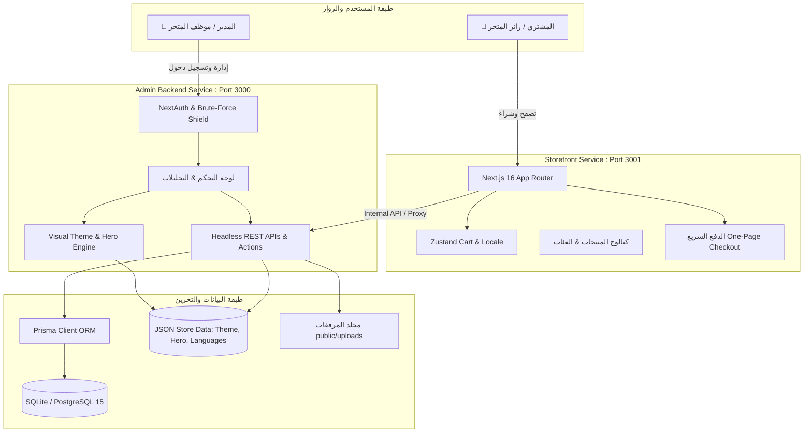
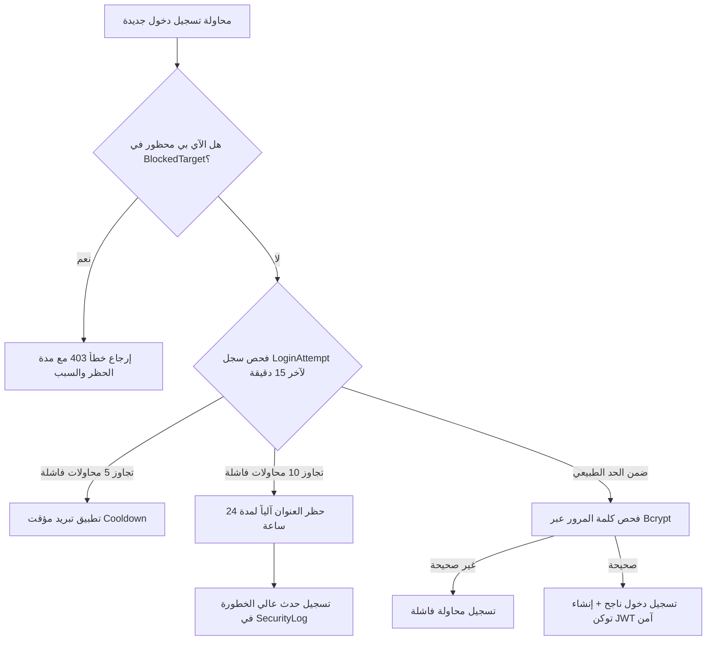

# 🛍️ التقرير التقني والهيكلي الشامل لمنصة Smomo (Smomo Platform)

> **تاريخ التقرير:** 2026-10-18  
> **الإصدار:** v1.0.0 Production-Ready Architecture  
> **المستودع:** [smomodashboard](file:///c:/Users/SIMO/Documents/smomodashboard) / [mohamedtandouri/smomo.shop](https://github.com/mohamedtandouri/smomo.shop.git)  

---

## 📑 فهرس المحتويات
1. [ملخص تنفيذي ونظرة عامة على المنصة](#1-ملخص-تنفيذي-ونظرة-عامة-على-المنصة)
2. [المكدس التقني الكامل (Full Technology Stack)](#2-المكدس-التقني-الكامل-full-technology-stack)
3. [الهيكل المعماري والنمط المنفصل (Decoupled Architecture)](#3-الهيكل-المعماري-والنمط-المنفصل-decoupled-architecture)
4. [شجرة الملفات وتفصيل المجلدات (Repository File Structure)](#4-شجرة-الملفات-وتفصيل-المجلدات-repository-file-structure)
5. [هندسة قاعدة البيانات والنماذج (Database & Prisma Architecture)](#5-هندسة-قاعدة-البيانات-والنماذج-database--prisma-architecture)
6. [نظام التخزين القائم على JSON والتهيئة المرنة](#6-نظام-التخزين-القائم-على-json-والتهيئة-المرنة)
7. [لوحة التحكم الإدارية (Admin Dashboard Deep Dive)](#7-لوحة-التحكم-الإدارية-admin-dashboard-deep-dive)
8. [متجر العملاء المستقل (Decoupled Storefront Experience)](#8-متجر-العملاء-المستقل-decoupled-storefront-experience)
9. [محرك الأمان والدفاع السيبراني (Cybersecurity & Defense Engine)](#9-محرك-الأمان-والدفاع-السيبراني-cybersecurity--defense-engine)
10. [دليل واجهات البرمجة والعمليات الخادمة (APIs & Server Actions)](#10-دليل-واجهات-البرمجة-والعمليات-الخادمة-apis--server-actions)
11. [بيئة DevOps، الحاويات وأتمتة CI/CD](#11-بيئة-devops-الحاويات-وأتمتة-cicd)
12. [دليل التثبيت والتشغيل المحلي السريع](#12-دليل-التثبيت-والتشغيل-المحلي-السريع)
13. [خلاصة وتقييم الجاهزية](#13-خلاصة-وتقييم-الجاهزية)

---

## 1. ملخص تنفيذي ونظرة عامة على المنصة

منصة **Smomo** هي منظومة تجارة إلكترونية متكاملة من الدرجة المؤسسية (Enterprise-Grade)، مصممة بنمط معماري منفصل حديث (**Headless / Decoupled Architecture**) يجمع بين:
- **لوحة تحكم إدارية متقدمة (`admin-backend`):** تقدم إدارة شاملة للمخزون، تتبع السلال المهجورة، محرك تخصيص سمات بصري مباشر، إدارة مسارات البيع (Funnels)، إدارة المستخدمين والصلاحيات الدقيقة، بالإضافة إلى نظام أمان سيبراني ذكي لصد هجمات القوة الغاشمة (Brute-Force).
- **واجهة متجر للعملاء فائقة السرعة (`storefront`):** متجر إلكتروني مستقل ومرن يركز على أعلى معدلات التحويل (Conversion Rate Optimization)، مزود بسلة تسوق لحظية، صفحة دفع واحدة سريعة (Express One-Page Checkout)، ودعم كامل متعدد اللغات والاتجاهات (RTL/LTR).

---

## 2. المكدس التقني الكامل (Full Technology Stack)

| الطبقة التقنية | التقنية المستخدمة | الإصدار | الغرض والدور |
| :--- | :--- | :--- | :--- |
| **إطار العمل الرئيسي** | **Next.js (App Router)** | `16.3.2` | بنية الصفحات الحديثة، SSR، Server Actions، ودعم محرك Turbopack فائق السرعة. |
| **مكتبة واجهة المستخدم** | **React** | `19.2.8` | بناء المكونات التفاعلية واستخدام أحدث Hooks وإمكانيات React 19. |
| **لغة البرمجة** | **TypeScript** | `5.x` | أمان الأنواع الصارم (Strict Type Safety) عبر الواجهات والخدمات ونماذج البيانات. |
| **محرك التنسيق** | **Tailwind CSS v4** | `4.x` | تنسيق مرئي حديث، أداء فائق دون ملفات زائدة، ودعم الثيم الداكن والفاتح. |
| **مكونات الواجهة** | **Radix UI / Shadcn UI** | Latest | مكونات واجهة مستخدم قياسية سهلة الوصول (Accessible Primitives). |
| **محرر النصوص الغني** | **Tiptap Editor** | `3.30.5` | محرر نصوص WYSIWYG متطور لإنشاء محتوى الصفحات والمقالات والوصف. |
| **مخططات البيانات** | **Recharts** | `3.10.1` | رسوم بيانية ومؤشرات تفاعلية لتحليلات المبيعات والإيرادات والزيارات. |
| **إدارة الحالة** | **Zustand** | `5.0.15` | إدارة حالة السلة (Cart State) واللغة الحالية (Locale Store) محلياً ولحظياً. |
| **المصادقة والتفويض** | **NextAuth.js + BcryptJS** | `4.24.15` | مصادقة آمنة، إدارة جلسات JWT، وتشفير كلمات المرور. |
| **قاعدة البيانات والـ ORM** | **Prisma ORM** | `5.22.0` | نمذجة واستعلامات قاعدة البيانات مع الحفاظ على دقة الأرقام المالية (`Decimal`). |
| **محركات قواعد البيانات** | **SQLite / PostgreSQL 15** | — | SQLite لسرعة التطوير المحلي بدون خادم، و PostgreSQL 15 لبيئة الإنتاج. |
| **التخزين المؤقت** | **Redis** | `7-alpine` | تخزين مؤقت للطلبات المتكررة والجلسات في بيئة Docker Compose. |
| **الأتمتة والحاويات** | **Docker & GitHub Actions** | — | تشغيل الحاويات بـ Multi-Stage builds مع خط سير CI لفحص الكود والبناء تلقائياً. |

---

## 3. الهيكل المعماري والنمط المنفصل (Decoupled Architecture)

تعتمد المنصة على فصل واجهة المتجر عن لوحة الإدارة لتحقيق أقصى درجات الأمان والأداء واستقلالية التوسع (Scalability):



---

## 4. شجرة الملفات وتفصيل المجلدات (Repository File Structure)

```
c:\Users\SIMO\Documents\smomodashboard
├── 📁 .github/
│   └── 📁 workflows/
│       └── 📄 ci.yml                  # مسار التكامل المستمر (GitHub Actions CI)
├── 📁 admin-backend/                 # تطبيق لوحة التحكم ومحرك الـ Backend (Port 3000)
│   ├── 📁 prisma/
│   │   ├── 📄 schema.prisma          # مخطط قاعدة بيانات الإدارة
│   │   ├── 📄 dev.db                 # قاعدة بيانات SQLite المحلية
│   │   └── 📁 store-data/            # ملفات الإعدادات والسمات بتنسيق JSON
│   │       ├── 📄 theme.json         # تخصيصات القالب البصري
│   │       ├── 📄 hero.json          # إعدادات قسم الواجهة الرئيسي (Hero)
│   │       ├── 📄 languages.json     # إعدادات اللغات والترجمات
│   │       └── 📄 user-permissions.json # مصفوفة الصلاحيات الدقيقة للمستخدمين
│   ├── 📁 public/
│   │   └── 📁 uploads/               # الصور والمرفقات والشعارات المحملة
│   ├── 📁 src/
│   │   ├── 📁 app/
│   │   │   ├── 📁 actions/           # خوادم العمليات (Server Actions)
│   │   │   │   ├── 📄 auth.ts        # مصادقة وتسجيل الدخول
│   │   │   │   ├── 📄 product.ts     # إدارة المنتجات
│   │   │   │   ├── 📄 category.ts    # إدارة التصنيفات
│   │   │   │   ├── 📄 orderActions.ts# دورة حياة الطلبات
│   │   │   │   ├── 📄 customer.ts    # إدارة بيانات العملاء
│   │   │   │   ├── 📄 users.ts       # إدارة الموظفين والمستخدمين
│   │   │   │   └── 📄 settings.ts    # إعدادات المتجر العامة
│   │   │   ├── 📁 admin/             # مسارات واجهات لوحة التحكم
│   │   │   │   ├── 📁 analytics/     # الرسوم البيانية والتقارير المالية
│   │   │   │   ├── 📁 customers/     # قائمة العملاء وسجل المشتريات
│   │   │   │   ├── 📁 insights/      # الرؤى التنبؤية ومؤشرات الأداء
│   │   │   │   ├── 📁 invoices/      # الفواتير وتحميل الـ PDF
│   │   │   │   ├── 📁 orders/        # معالجة الطلبات والحالات
│   │   │   │   ├── 📁 products/      # المنتجات، تفاصيلها، والجرد
│   │   │   │   ├── 📁 profile/       # الملف الشخصي وتغيير كلمة المرور
│   │   │   │   ├── 📁 store/         # محرك المتجر (سمات، هيرو، قوائم، لغات، صفحات، مسارات)
│   │   │   │   └── 📁 users/         # إدارة مدراء النظام والصلاحيات
│   │   │   └── 📁 api/               # واجهات REST API لكافة الوحدات
│   │   ├── 📁 components/            # مكونات واجهة الإدارة (Header, Sidebar, Modals, Forms)
│   │   └── 📁 lib/                   # مكتبات المساعدة والأمان
│   │       ├── 📄 auth.ts            # تهيئة NextAuth وحساب الجلسات
│   │       ├── 📄 security.ts        # محرك الدفاع ضد Brute Force وتتبع الآي بي
│   │       ├── 📄 store-storage.ts   # إدارة حفظ وقراءة إعدادات المتجر JSON
│   │       ├── 📄 hero-config.ts     # مدير إعدادات قسم الهيرو
│   │       └── 📄 permissions-config.ts # منطق الصلاحيات والأدوار
│   ├── 📄 Dockerfile                 # بناء صورة Docker للوحة التحكم
│   └── 📄 package.json               # حزم لوحة التحكم المستقلة
│
├── 📁 storefront/                    # تطبيق متجر العملاء المستقل (Port 3001)
│   ├── 📁 public/
│   │   └── 📁 uploads/               # استعراض مرفقات المتجر والصور
│   ├── 📁 src/
│   │   ├── 📁 app/
│   │   │   └── 📁 store/             # مسارات صفحات المتجر
│   │   │       ├── 📄 page.tsx       # الصفحة الرئيسية التفاعلية
│   │   │       ├── 📁 products/      # كتالوج المنتجات وتفاصيل المنتج الفردي
│   │   │       ├── 📁 categories/    # استعراض التصنيفات
│   │   │       ├── 📁 cart/          # صفحة واستعراض السلة
│   │   │       ├── 📁 checkout/      # صفحة إتمام الطلب الفوري
│   │   │       ├── 📁 [slug]/        # الصفحات الديناميكية (من نحن، الشروط، سياسة الخصوصية)
│   │   │       └── 📁 dashboard/     # بوابة حساب العميل
│   │   ├── 📁 components/storefront/ # مكونات المتجر (Navbar, Footer, ProductView, Hero)
│   │   ├── 📁 store/                 # مخازن Zustand (useCartStore, useLocaleStore)
│   │   └── 📄 proxy.ts               # حماية التوجيه وإعادة التوجيه الآمنة
│   ├── 📄 Dockerfile                 # بناء صورة Docker لواجهة المتجر
│   └── 📄 package.json               # حزم المتجر المستقلة
│
├── 📁 prisma/                        # قاعدة البيانات المشتركة وجداول البذر
│   ├── 📄 schema.prisma              # المخطط العام المركزي
│   ├── 📄 dev.db                     # قاعدة بيانات التطوير المحلية
│   ├── 📄 seed-inventory.js          # سكريبت توليد بيانات الجرد الواقعية
│   ├── 📄 seed-abandoned-carts.js    # سكريبت توليد بيانات السلال المهجورة
│   └── 📄 seed-reviews.js            # سكريبت توليد مراجعات المنتجات
│
├── 📄 docker-compose.yml             # تشغيل المنظومة الكاملة (Postgres, Redis, Admin, Store)
├── 📄 Dockerfile                     # صورة Docker الجذرية الشاملة
├── 📄 run-all.mjs                    # مشغل متزامن لخدمتي الإدارة والمتجر معاً بأمر واحد
├── 📄 package.json                   # الحزمة الجذرية الشاملة مع أوامر التشغيل والبناء
└── 📄 .gitignore                     # استبعاد ملفات الكاش، النسخ الاحتياطية .bak والبيانات الحساسة
```

---

## 5. هندسة قاعدة البيانات والنماذج (Database & Prisma Architecture)

يحتوي ملف المخطط [`prisma/schema.prisma`](file:///c:/Users/SIMO/Documents/smomodashboard/prisma/schema.prisma) على **13 نموذجاً (Model)** مصممة بدقة عالية لضمان تكامل العلاقات المحاسبية وحماية البيانات:

### 1. جدول النماذج ودور كل جدول:

| اسم النموذج (Model) | الحقول الرئيسية | الغرض الوظيفي |
| :--- | :--- | :--- |
| **`User`** | `id`, `name`, `email`, `password`, `role`, `status`, `phone` | الحسابات الرئيسية للمستخدمين والمدراء مع حالات `ACTIVE` و `SUSPENDED`. |
| **`Profile`** | `userId`, `address`, `city`, `zipCode`, `country` | بيانات العناوين والموقع الجغرافي المرتبطة بالمستخدم بحذف متسلسل `Cascade`. |
| **`Category`** | `id`, `name`, `description`, `imageUrl` | تصنيفات المنتجات وفهرستها مع دعم الصور التوضيحية. |
| **`Product`** | `id`, `sku`, `name`, `price`, `compareAtPrice`, `stock`, `views` | بيانات المنتجات والأسعار بدقة `Decimal` لمنع أخطاء التقريب المالي. |
| **`Order`** | `orderNumber`, `customerName`, `status`, `subtotal`, `total` | تتبع الطلبات وحالاتها: `Processing`, `Shipped`, `Delivered`, `Cancelled`. |
| **`OrderItem`** | `orderId`, `productId`, `quantity`, `price` | العناصر الفردية المرتبطة بالطلب مع تسجيل سعر الشراء اللحظي. |
| **`Coupon`** | `code`, `discountType`, `discountValue`, `isActive` | كوبونات الخصم التسويقية بقيم ثابتة أو نسب مئوية. |
| **`UpSell`** | `targetProductId`, `offerProductId`, `discount`, `isActive` | عروض البيع الإضافي التفاعلية لزيادة متوسط قيمة الطلب (AOV). |
| **`Review`** | `productId`, `userId`, `rating`, `comment`, `status` | تقييمات العملاء مع نظام إشراف ثلاثي: `APPROVED`, `PENDING`, `REJECTED`. |
| **`StoreSettings`** | `storeName`, `logoUrl`, `primaryColor`, `isMaintenanceMode` | إعدادات هوية المتجر والوضع تحت الصيانة (Singleton record). |
| **`HeroSection`** | `title`, `subtitle`, `buttonText`, `buttonUrl`, `imagePath` | التخصيص الحي لواجهة الصفحة الرئيسية للهيرو والعناوين والشعارات العائمة. |
| **`AbandonedCart`** | `customerEmail`, `totalValue`, `status`, `recoveryEmailSentAt` | رصد السلال المتروكة وتتبع إرسال رسائل الاسترداد التلقائية. |
| **`InventoryReview`** | `reviewCode`, `expected`, `actual`, `status: discrepancy/matched` | عمليات الجرد المخزني الفعلي ومقارنة المتوقع بالواقعي (`REV-XXX`). |
| **`LoginAttempt`** | `ipAddress`, `email`, `success`, `createdAt` | تسجيل كل محاولات الدخول لحساب معدل الطلبات واكتشاف الهجمات. |
| **`BlockedTarget`** | `ipAddress`, `reason`, `isPermanent`, `blockedUntil` | سجل عناوين IP المحظورة تلقائياً مع مدة الحظر المؤقتة أو الدائمة. |
| **`SecurityLog`** | `eventType`, `severity`, `ipAddress`, `details` | سجل الرقابة الأمنية لتوثيق أحداث النظام الحرجة. |

---

## 6. نظام التخزين القائم على JSON والتهيئة المرنة

إلى جانب قاعدة البيانات العلائقية، تدعم المنصة بنية تخزين مرنة وسريعة جداً للملفات والإعدادات التي تحتاج استجابة فورية عبر مجلد `admin-backend/prisma/store-data/`:

1. **[`theme.json`](file:///c:/Users/SIMO/Documents/smomodashboard/admin-backend/prisma/store-data/theme.json):**
   - تحكم كامل بهيكل الصفحة الرئيسية (عرض السلايدر، ترتيب أقسام المنتجات، نوع الشبكة Grid vs Slider).
   - خيارات رأس الصفحة (Header) وتذييلها (Footer) وإمكانية تفعيل الالتصاق (Sticky Navbar).
   - إعدادات صفحة الدفع (الخطوط المستخدمة، الألوان الأساسية، الحقول المطلوبة).
   - بانر أسفل السلة الإعلاني بمقاس $1064 \times 132$.

2. **[`hero.json`](file:///c:/Users/SIMO/Documents/smomodashboard/admin-backend/prisma/store-data/hero.json):**
   - حفظ قيم الترويسة الرئيسية، الأزرار، والوسوم العائمة (Floating Badges مثل `10k+ Happy Customers`).

3. **[`languages.json`](file:///c:/Users/SIMO/Documents/smomodashboard/admin-backend/prisma/store-data/languages.json):**
   - دعم التبديل التلقائي بين:
     - 🇸🇦 العربية (Arabic - RTL)
     - 🇬🇧 الإنجليزية (English - LTR)
     - 🇫🇷 الفرنسية (French - LTR)
   - تتبع نسب اكتمال الترجمة وتعيين اللغة الافتراضية.

4. **[`user-permissions.json`](file:///c:/Users/SIMO/Documents/smomodashboard/admin-backend/prisma/store-data/user-permissions.json):**
   - تحديد صلاحيات كل دور بدقة (إمكانية القراءة، الكتابة، الحذف، وتعديل إعدادات المتجر).

---

## 7. لوحة التحكم الإدارية (Admin Dashboard Deep Dive)

تعتبر لوحة التحكم الإدارية عصب المنظومة، وتتوزع وظائفها على المسارات التالية:

### 🏬 1. محرك إدارة المتجر (`/admin/store/*`)
- **الملخص العام (`/admin/store`):** مؤشرات حية لحالة المتجر، أزرار معاينة سريعة للهاتف المحمول وسطح المكتب.
- **محرر القوالب المرئي (`/admin/store/theme`):** بيئة تفاعلية تسمح بتعديل ألوان وأقسام المتجر فورياً مع إمكانية تصدير واستيراد الإعدادات بملفات JSON بنقرة واحدة.
- **محرر واجهة الهيرو (`/admin/store/hero`):** رفع صور الهيرو، كتابة النصوص التسويقية، وتخصيص ألوان الأزرار.
- **مكتبة السمات (`/admin/store/themes`):** التبديل بين قوالب جاهزة متعددة وتثبيت قوالب جديدة من أرشيف ZIP.
- **إدارة القوائم (`/admin/store/menus`):** تعديل قوائم الهيدر والفوتر وترتيب الروابط بالسحب والإفلات.
- **مسارات المبيعات (`/admin/store/funnels`):** إنشاء مسارات تسويقية مركزة لمنتج واحد (Landing $\rightarrow$ Checkout $\rightarrow$ Upsell $\rightarrow$ Thank You).
- **الصفحات الثابتة CMS (`/admin/store/pages`):** محرر صفحات مدمج لإدارة صفحات الشروط والأحكام، سياسة الخصوصية، والأسئلة الشائعة بروابط SEO صديقة.

### 📦 2. إدارة المنتجات والمخزون الحي (`/admin/products/*`)
- **كتالوج المنتجات الكامل:** إضافة المنتجات مع صور متعددة، متغيرات المقاس واللون، وتحديد أسعار المقارنة.
- **جدول الجرد الحي:** حساب تلقائي لحالة المخزون وتصنيفها بألوان واضحة:
  - 🟢 `In Stock`: متوفر بكمية كافية.
  - 🟡 `Low Stock`: كمية منخفضة ($\le 20$ قطعة).
  - 🔴 `Out of Stock`: نفاد تام من المستودع.
- **تدقيق الفروقات المخزنية (`/admin/products/inventory/reviews`):** توليد تقارير تدقيق رسمية بكود `REV-XXX` لمطابقة الجرد الفعلي على الأرض بالمسجل برمجياً.

### 🛒 3. معالجة الطلبات واسترداد السلال المهجورة
- **إدارة الطلبات (`/admin/orders`):** تحديث مراحل التوصيل، طباعة الفواتير، وحساب الأرباح الصافية.
- **استرداد السلال المهجورة (`/admin/abandoned-carts`):** رصد العملاء الذين غادروا دون إتمام الشراء، وإرسال قسائم خصم تحفيزية تلقائية (مثل `COMEBACK15`).

### 👥 4. المستخدمين والملف الشخصي
- **إدارة المستخدمين (`/admin/users`):** تعيين أدوار المدراء والموظفين والتحكم في إمكانية وصولهم للأقسام الحساسة.
- **الملف الشخصي (`/admin/profile`):** تعديل البيانات الشخصية، الصورة الرمزية، وتغيير كلمة المرور المشفرة.

---

## 8. متجر العملاء المستقل (Decoupled Storefront Experience)

تم بناء المتجر [`storefront`](file:///c:/Users/SIMO/Documents/smomodashboard/storefront) ليوفر تجربة تسوق استثنائية وسريعة:

1. **الصفحة الرئيسية (`/store`):**
   - شريط إعلاني ديناميكي في الأعلى قابل للتفعيل والتعطيل من الإدارة.
   - قسم الهيرو الرئيسي المتجاوب مع مؤشرات الثقة وشارات التقييم.
   - عروض المنتجات الأفضل مبيعاً وأحدث التخفيضات.

2. **صفحة تفاصيل المنتج (`/store/products/[id]`):**
   - عدسة تكبير تفاعلية للصور (Zoom Lens).
   - مبدل الألوان والمتغيرات مع تعديل السعر والصورة لحظياً.
   - مؤقت العد التنازلي للندرة وتنبيه عدد الزوار الحاليين لتحفيز قرار الشراء الفوري.
   - قسم المراجعات والتقييمات بالنجوم مع نموذج إضافة تقييم معتمد.

3. **سلة التسوق التفاعلية (`Zustand Cart`):**
   - درج جانبي سريع (Side Drawer) يفتح فور النقر دون مغادرة الصفحة.
   - حساب فوري لمجموع المنتجات، الشحن، والخصومات.
   - إمكانية تطبيق كوبونات الخصم والتحقق منها مباشرة عبر الـ API.

4. **صفحة الدفع السريع المباشر (`/store/checkout`):**
   - صفحة دفع واحدة تركز على إتمام الشراء دون تعقيد للزوار (Guest Checkout).
   - نموذج استلام واضح مع اختيار طريقة الدفع عند الاستلام (COD).

5. **دعم تعدد اللغات (Multilingual & RTL):**
   - تبديل فوري بين العربية، الإنجليزية، والفرنسية مع قلب اتجاه الصفحة (`dir="rtl"` أو `dir="ltr"`) تلقائياً.

---

## 9. محرك الأمان والدفاع السيبراني (Cybersecurity & Defense Engine)

تتضمن المنصة نظام حماية متقدم مطبق في [`admin-backend/src/lib/security.ts`](file:///c:/Users/SIMO/Documents/smomodashboard/admin-backend/src/lib/security.ts):



- **تشفير كلمات المرور:** باستخدام خوارزمية التجزئة الآمنة `bcryptjs` مع Salt متقدم.
- **حماية جلسات الـ JWT:** توثيق الجلسات بـ `NEXTAUTH_SECRET` مشفر ومنع تزوير الجلسات.
- **جدران الحماية (Guards & Proxy):** فحص صلاحيات المستخدم قبل الوصول لأي مسار في لوحة الإدارة، مع توجيه غير المصرح لهم تلقائياً إلى صفحة `unauthorized`.

---

## 10. دليل واجهات البرمجة والعمليات الخادمة (APIs & Server Actions)

### أ. واجهات الـ REST API الرئيسية:

| المسار (Endpoint) | الطريقة (Method) | الوصف |
| :--- | :---: | :--- |
| `/api/products` | `GET` / `POST` | جلب قائمة المنتجات مع الفلترة أو إضافة منتج جديد. |
| `/api/products/[id]` | `GET` / `PUT` / `DELETE` | جلب تفاصيل، تعديل، أو حذف منتج محدد. |
| `/api/orders` | `GET` / `POST` | استرجاع الطلبات للمدير، أو تسجيل طلب جديد من المتجر. |
| `/api/categories` | `GET` / `POST` | إدارة تصنيفات المتجر. |
| `/api/reviews` | `GET` / `POST` / `PATCH` | جلب المراجعات المعتمدة، إرسال تقييم جديد، أو اعتماد/رفض مراجعة. |
| `/api/coupons` | `GET` / `POST` | التحقق من صلاحية قسيمة التخفيض أو توليد قسائم جديدة. |
| `/api/store/theme` | `GET` / `POST` | جلب إعدادات القالب للمتجر أو حفظ التعديلات البصرية. |
| `/api/store/hero` | `GET` / `POST` | قراءة وحفظ إعدادات الهيرو الترويجي. |
| `/api/store/languages`| `GET` / `POST` | جلب اللغات المدعومة وتحديث ملفات الترجمة. |
| `/api/abandoned-carts`| `GET` / `POST` | جلب السلال المتروكة وتشغيل حملات الاسترداد البريدية. |
| `/api/inventory` | `GET` / `POST` | مراجعة مستويات المخزون وحفظ جلسات الجرد `InventoryReview`. |

### ب. خوادم العمليات (Server Actions):

- **[`actions/auth.ts`](file:///c:/Users/SIMO/Documents/smomodashboard/admin-backend/src/app/actions/auth.ts):** معالجة تسجيل الدخول، تسجيل الحسابات، والخروج.
- **[`actions/product.ts`](file:///c:/Users/SIMO/Documents/smomodashboard/admin-backend/src/app/actions/product.ts):** عمليات التحديث السريع للمنتجات وحذفها وتعديل أسعارها.
- **[`actions/orderActions.ts`](file:///c:/Users/SIMO/Documents/smomodashboard/admin-backend/src/app/actions/orderActions.ts):** تغيير حالات الطلبات وإلغائها وإعادة احتساب الضرائب.
- **[`actions/users.ts`](file:///c:/Users/SIMO/Documents/smomodashboard/admin-backend/src/app/actions/users.ts):** تعديل رتب المستخدمين وتجميد الحسابات.
- **[`actions/settings.ts`](file:///c:/Users/SIMO/Documents/smomodashboard/admin-backend/src/app/actions/settings.ts):** تحديث بيانات المتجر الأساسية والشعار وألوان العلامة التجارية.

---

## 11. بيئة DevOps، الحاويات وأتمتة CI/CD

### 1. خط سير التكامل المستمر (GitHub Actions CI)
تم إعداد ملف العمليات في [`.github/workflows/ci.yml`](file:///c:/Users/SIMO/Documents/smomodashboard/.github/workflows/ci.yml) ليعمل تلقائياً عند الدفع (`Push`) أو فتح طلب سحب (`Pull Request`) لفروع `main` و `master`:
- **تهيئة البيئة:** نظام تشغيل `ubuntu-latest` مع `Node.js 20` وتفعيل التخزين المؤقت لحزم npm.
- **توليد Prisma:** تشغيل `npx prisma generate` لكل من الجذر ولوحة التحكم لضمان تطابق المخطط.
- **فحص الكود (Linting):** التأكد من عدم وجود أخطاء صياغة باستخدام ESLint.
- **بناء التطبيقات:** بناء `admin-backend` وبناء `storefront` للتأكد من عدم وجود أخطاء في الـ TypeScript.
- **التحقق من حاوية Docker:** بناء تجريبي لصورة الـ Docker للتأكد من مطابقتها لمعايير بيئة الإنتاج.

### 2. بيئة Docker Compose المتكاملة
يحتوي المستودع على [`docker-compose.yml`](file:///c:/Users/SIMO/Documents/smomodashboard/docker-compose.yml) الجاهز لتشغيل:
1. خادم قاعدة بيانات **PostgreSQL 15**.
2. خادم تخزين مؤقت **Redis 7**.
3. خادم لوحة التحكم **Admin Backend** على المنفذ `3000`.
4. خادم واجهة المتجر **Storefront** على المنفذ `3001`.

---

## 12. دليل التثبيت والتشغيل المحلي السريع

### المتطلبات الأساسية
- بيئة **Node.js 20+**
- أداة الحزم **npm** أو **pnpm**
- (اختياري) **Docker Desktop**

### خطوات التشغيل المحلي خطوة بخطوة:

1. **تثبيت الاعتماديات:**
   ```bash
   npm install
   ```

2. **توليد قاعدة البيانات وبذر البيانات التجريبية:**
   ```bash
   # مزامنة مخطط قاعدة البيانات
   npx prisma db push

   # بذر البيانات التجريبية للمنتجات والمخزون والمراجعات
   node prisma/seed-inventory.js
   node prisma/seed-abandoned-carts.js
   node prisma/seed-reviews.js
   ```

3. **تشغيل المنظومة كاملة بأمر واحد (الأمر الموصى به):**
   ```bash
   npm run dev:all
   ```
   *يقوم هذا الأمر بتشغيل سكربت [`run-all.mjs`](file:///c:/Users/SIMO/Documents/smomodashboard/run-all.mjs) الذي يبدأ المنصتين معاً:*
   - **لوحة التحكم (Admin):** [http://localhost:3000/admin](http://localhost:3000/admin)
   - **متجر العملاء (Storefront):** [http://localhost:3001/store](http://localhost:3001/store)

4. **التشغيل المنفرد (إذا أردت تشغيل خدمة واحدة فقط):**
   ```bash
   # تشغيل لوحة التحكم فقط
   npm run dev:admin

   # تشغيل متجر العملاء فقط
   npm run dev:storefront
   ```

---

## 13. خلاصة وتقييم الجاهزية

| الجانب التقني | حالة التقييم | ملاحظات ومؤشرات الجودة |
| :--- | :---: | :--- |
| **هندسة البرمجيات (Architecture)** | ⭐️⭐️⭐️⭐️⭐️ ممتاز | نمط Headless نظيف يعزل المتجر عن الإدارة ويسهل التوسع المستقبلي. |
| **أداء واجهة المستخدم (UI/UX)** | ⭐️⭐️⭐️⭐️⭐️ ممتاز | مبني بأحدث إصدارات Next.js 16 و React 19 مع دعم الثيم الداكن والتجاوب الكامل. |
| **دقة البيانات المحاسبية** | ⭐️⭐️⭐️⭐️⭐️ ممتاز | استخدام أنواع `Decimal` في كل التعاملات المالية يمنع أي أخطاء حسابية. |
| **الأمان السيبراني (Security)** | ⭐️⭐️⭐️⭐️⭐️ ممتاز | حماية ضد هجمات القوة الغاشمة، سجلات تدقيق، ونظام تبريد وحظر آلي للعناوين المشبوهة. |
| **التوافق مع DevOps** | ⭐️⭐️⭐️⭐️⭐️ ممتاز | دعم أصيل لـ Docker Compose ومسار عمل آلي GitHub Actions CI. |

---
**تم إنشاء هذا التقرير التقني بنجاح لتوثيق كامل البنية المعمارية لمنصة Smomo.**
