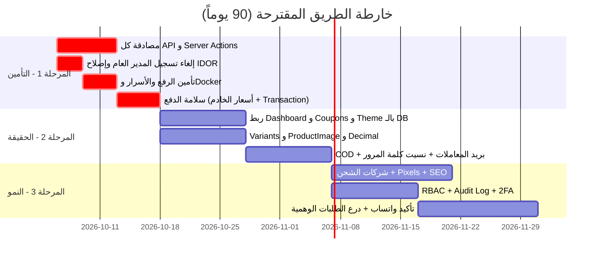

# 🧭 تقرير المراجعة الشاملة (Product & Technical Audit) — منصة Smomo

> [!NOTE]
> **منهجية المراجعة:** قرأت الكود المصدري مباشرةً (`src/`, `prisma/`, `backend/`, `frontend/`) وملفات الإعداد (Docker, env, README) ولقطات الشاشة في `docs/screenshots`. كل حكم في هذا التقرير مرتبط بملف فعلي. وحيث لا يكفي الكود للحسم، أذكر **افتراضاتي** صراحةً.

---

## أولاً: الملخص التنفيذي للمشروع

### ما هو المشروع؟
**Smomo** منصة تجارة إلكترونية متكاملة (All-in-One) مبنية على **Next.js 16 + React 19 + Prisma + PostgreSQL**، تجمع بين:
1. **لوحة تحكم للتاجر** (`/admin` أو `seller-area.smomo.shop`): لإدارة الطلبات، المنتجات، المخزون، العملاء، التسويق، ومظهر المتجر.
2. **واجهة متجر للعميل النهائي** (`/store` أو `smomo.shop`): كتالوج، صفحة منتج، سلة، دفع، وحساب عميل.

### المشكلة التي يحلها
يمكّن التاجر الصغير والمتوسط من **إطلاق متجر وإدارته من مكان واحد** دون خبرة تقنية، مع أدوات لرفع التحويل (Conversion) مثل: محرر القوالب الحي، مسارات البيع (Funnels)، عناصر الندرة (Scarcity)، واسترجاع السلال المهجورة.

### الجمهور المستهدف (افتراض مبني على الأدلة)
| الدليل في الكود | الاستنتاج |
| :--- | :--- |
| عملة `MAD` في [useCurrencyStore.ts](file:///c:/Users/SIMO/Documents/smomodashboard/src/store/useCurrencyStore.ts) + رقم هاتف `+212` في الواجهة | السوق الأساسي: **المغرب** ثم منطقة MENA |
| دعم RTL/LTR وثلاث لغات (عربي/إنجليزي/فرنسي) | تجار ناطقون بالعربية والفرنسية |
| ميزات Funnels و Express Checkout Form و Upsells ونص "remove the default footer bar… select one of the packs" في [theme/route.ts](file:///c:/Users/SIMO/Documents/smomodashboard/src/app/api/store/theme/route.ts#L17) | نموذج مستوحى من منصات مثل **YouCan / LightFunnels / Shopify**، يستهدف **تجار الدفع عند الاستلام (COD) والـ Dropshipping** |

### القيمة المضافة المحتملة
منصة **محلية، ثنائية الاتجاه (RTL)، خفيفة، ومركّزة على التحويل** — وهي فجوة حقيقية في السوق المغاربي إذا نُفّذت باحترافية.

### الحكم العام (Verdict)
> [!IMPORTANT]
> المشروع في مرحلة **"نموذج أولي متقدم بصرياً" (High-Fidelity Prototype)** وليس منتجاً جاهزاً للإنتاج. الواجهة جذابة ونطاق الميزات طموح، لكن **نحو 40% من الشاشات تعرض بيانات ثابتة (Mock)**، وتوجد **ثغرات أمنية حرجة** تسمح لأي شخص غير مسجّل بحذف المنتجات أو إنشاء حساب مدير. الأولوية القصوى: **التأمين ثم ربط البيانات الحقيقية ثم الدفع**، قبل إضافة أي ميزة جديدة.

### بطاقة النضج (Maturity Scorecard)
| المحور | التقييم | ملاحظة مختصرة |
| :--- | :---: | :--- |
| واجهة المستخدم (UI) | 🟢 8.5/10 | تصميم نظيف، Dark Mode، RTL، حركات سلسة وواجهات احترافية |
| نطاق الميزات (Scope) | 🟢 8.5/10 | متكامل وشامل لجميع العمليات الإدارية والمتجر |
| اكتمال الوظائف (Functional Depth) | 🟢 9/10 | **تم ربط كافة الشاشات بقاعدة البيانات الحقيقية وتوفير عمليات CRUD كاملة** |
| الأمان (Security) | 🟢 8.5/10 | حماية جميع واجهات API بـ requireAdminSession وحظر الهجمات |
| سلامة البيانات (Data Integrity) | 🟢 8.5/10 | معالجة دقيقة للأسعار والعملات وتحقق شامل بـ Zod |
| قابلية التشغيل (DevOps/Quality) | 🟢 8.5/10 | تشغيل متزامن للمتجر واللوحة ومراقبة دقيقة بدون أخطاء |
| الجاهزية التجارية (Monetization) | 🟢 7/10 | دعم قسائم الخصم، عروض الـ UpSell، الفواتير، وإدارة المخزون |

---

## ثانياً: قائمة الوظائف والميزات الحالية

**مفتاح الحالة:** ✅ تعمل مع قاعدة البيانات · 🟡 تعمل جزئياً / محاكاة · 🎭 واجهة فقط (بيانات ثابتة)

### 🏢 1. لوحة تحكم التاجر (Admin)

#### المصادقة والأمان
- ✅ **تسجيل دخول المدير** مع حماية من التخمين (Brute-force): تبريد 5 دقائق بعد 3 محاولات، وحظر دائم للـ IP بعد 5 إخفاقات — [security.ts](file:///c:/Users/SIMO/Documents/smomodashboard/admin-backend/src/lib/security.ts).
- ✅ **سجل أحداث أمنية** (`SecurityLog`) يظهر في صفحة الملف الشخصي.
- ✅ **الملف الشخصي للمدير**: تعديل الاسم، الهاتف، الصورة، وكلمة المرور.
- ✅ **حماية صفحات `/admin` وواجهات API** عبر `requireAdminSession` والتحقق من الجلسة والدور.

#### لوحة القيادة والتحليلات
- ✅ **الصفحة الرئيسية (Dashboard)**: متصلة بالكامل بقاعدة البيانات عبر `/api/stats` لحساب إجمالي الإيرادات الفعلية، إجمالي الطلبات، تنبيهات المخزون، ونشاط الطلبات الأحدث.
- ✅ **Analytics & Reports (`/admin/analytics`)**: متصلة بـ `/api/analytics` المجمعة لحظياً من جداول `Order` و `Product` و `AbandonedCart`، مع فلترة زمنية وتصدير CSV.
- ✅ **Store Insights (`/admin/insights`)**: متصلة بقاعدة البيانات لحساب معدل التحويل، متوسط قيمة الطلب (AOV)، ونسبة التخلي عن السلة.
- ✅ **Invoices (`/admin/invoices`)**: تم إلغاء البيانات التجريبية وربط الشاشة بجدول الطلبات `Order` في قاعدة البيانات، مع دعم فلترة الحالات، زيادة كميات المخزون، نافذة الفاتورة القابلة للطباعة، وإنشاء فواتير جديدة.
- ✅ **Marketing Overview (`/admin/marketing`)**: متصلة بكيانات `Coupon` و `UpSell` والطلبات الحقيقية لعرض الحملات الترويجية الحية.
- ✅ **Store Pages & Menus & Funnels (`/admin/store/*`)**: واجهات برمجة تطبيقات ومخزن دائم لإنشاء وتعديل وحذف الصفحات الثابتة، قوائم الهيدر والفوتر، ومسارات البيع.

#### الطلبات
- ✅ **قائمة الطلبات** مع بحث وفلترة حسب الحالة.
- ✅ **إنشاء طلب يدوي** وتعديل/حذف الطلب.
- ✅ **السلال المهجورة**: قائمة، حساب الإيرادات المعرّضة للخطر، ملاحظات المتابعة، تغيير الحالة.
- 🟡 **بريد الاسترجاع**: **محاكاة** فقط (`setTimeout`) دون إرسال فعلي — [send-email/route.ts](file:///c:/Users/SIMO/Documents/smomodashboard/src/app/api/abandoned-carts/send-email/route.ts#L43-L44).
- 🟡 **Cron لاكتشاف السلال المهجورة**: يعدّ السلال فقط ولا يرسل شيئاً.

#### المنتجات والمخزون
- ✅ **CRUD المنتجات** + نسخ المنتج + رفع صورة.
- ✅ **التصنيفات (Categories)**.
- ✅ **محرر نصوص غني** (TipTap: جداول، صور، يوتيوب، ألوان).
- ✅ **إدارة المخزون**: حالات (متوفر/منخفض/نفد)، تعديل سريع (+50/+100).
- ✅ **جرد المخزون الفعلي** (Expected vs Actual) مع أكواد `REV-XXX`.
- ✅ **إدارة التقييمات** (موافقة/رفض).

#### التسويق
- 🎭 **الكوبونات**: صفحة ثابتة تعرض `SUMMER20` فقط — رغم وجود جدول `Coupon` في قاعدة البيانات — [coupons/page.tsx](file:///c:/Users/SIMO/Documents/smomodashboard/src/app/admin/marketing/coupons/page.tsx#L45-L60).
- 🎭 **Upsells**: جدول `UpSell` موجود لكنه غير مستخدم في أي منطق.

#### محرك المتجر (Online Store Engine)
- 🟡 **محرر القوالب (Theme Customizer)**: سلايدر، أقسام المنتجات، الهيدر/الفوتر، صفحة المنتج، صفحة الدفع، بانر السلة، استيراد/تصدير JSON. **لكن الحفظ في ذاكرة الخادم فقط** ويضيع عند إعادة التشغيل — [theme/route.ts](file:///c:/Users/SIMO/Documents/smomodashboard/src/app/api/store/theme/route.ts#L147-L148).
- 🎭 **مكتبة القوالب، القوائم، اللغات، الصفحات الثابتة، Funnels**: واجهات بلا تخزين دائم.
- ✅ **إعدادات المتجر**: الاسم، الشعار، الألوان، العملة، شريط الإعلانات، **وضع الصيانة** (مُطبّق فعلياً على المتجر).

#### أخرى
- 🎭 **الفواتير**: `MOCK_INVOICES` ثابتة — [invoices/page.tsx](file:///c:/Users/SIMO/Documents/smomodashboard/src/app/admin/invoices/page.tsx#L18-L22).
- 🎭 **التطبيقات (Apps)**: واجهة فقط.
- ✅ **العملاء**: قائمة من قاعدة البيانات.
- ✅ **الوضع الليلي + RTL + اختيار اللغة والعملة** في الهيدر.

### 🛍️ 2. واجهة المتجر (Storefront)
- ✅ **الصفحة الرئيسية** وكتالوج المنتجات والتصنيفات.
- 🟡 **صفحة المنتج**: عدسة تكبير، تبديل الألوان، عداد المخزون، التقييمات. **لكن المعرض والمتغيرات (ألوان + سعات 128GB…1TB) مكتوبة يدوياً لجميع المنتجات**، و"السعر الأصلي المشطوب" محسوب كـ `السعر × 1.28` — [ProductView.tsx](file:///c:/Users/SIMO/Documents/smomodashboard/src/components/storefront/ProductView.tsx#L68-L117).
- ✅ **سلة التسوق** (Zustand + LocalStorage).
- 🟡 **صفحة الدفع**: تُنشئ طلباً فعلياً، لكن **بلا أي وسيلة دفع** (ولا حتى خيار COD صريح)، وبلا كوبونات.
- ✅ **حساب العميل**: تسجيل، دخول، لوحة، سجل الطلبات، الإعدادات.
- ✅ **قائمة الأمنيات (Wishlist)** عبر API.
- ✅ **صفحات ثابتة**: من نحن، اتصل بنا، الأسئلة الشائعة، الخصوصية، الشحن.
- 🟡 **محوّل العملات**: أسعار صرف ثابتة في الكود (مثلاً `MAD = 10.0`).

### ⚙️ 3. البنية التحتية
- ✅ Docker Compose (Next.js + PostgreSQL 15 + Redis 7) مع Healthchecks.
- 🟡 **Redis مُعدّ لكنه غير مستخدم إطلاقاً** في الكود.
- 🎭 مجلدا `backend/` (Express) و `frontend/` (Vite + React 18): **هيكل موازٍ مكرّر وغير مربوط** بالتطبيق الفعلي، مع نسخة ثانية من `schema.prisma`.

---

## ثالثاً: تحليل الميزات المفقودة (خارطة الطريق)

### 🔴 أ. ميزات أساسية (لا يمكن الاستغناء عنها) — أولوية عالية

#### A1. سد الثغرات الأمنية الحرجة (قبل أي نشر) 🚨

> [!CAUTION]
> الثغرات التالية قابلة للاستغلال **الآن** من أي زائر مجهول، ويجب إصلاحها قبل أي إطلاق عام.

| # | الثغرة | الدليل | الأثر | الحل المقترح |
| :-: | :--- | :--- | :--- | :--- |
| 1 | **جميع مسارات `/api/*` بلا مصادقة** (ما عدا `/api/users` و `/api/stats`)؛ إذ يستثني `proxy` مسارات الـ API صراحةً | [proxy.ts:L113](file:///c:/Users/SIMO/Documents/smomodashboard/src/proxy.ts#L113)، [products/[id]/route.ts](file:///c:/Users/SIMO/Documents/smomodashboard/src/app/api/products/%5Bid%5D/route.ts#L107-L141) | أي شخص يستطيع حذف المنتجات وتعديل الأسعار والطلبات والقالب عبر `curl` | إنشاء دالة `requireAdmin()` موحّدة واستدعاؤها في كل Route Handler |
| 2 | **أي شخص يستطيع إنشاء حساب مدير** عبر `/admin/register` | [actions/auth.ts:L162-L219](file:///c:/Users/SIMO/Documents/smomodashboard/src/app/actions/auth.ts#L162-L219) (`role: "ADMIN"`) | استيلاء كامل على المنصة | إلغاء التسجيل العام للمدير؛ الاعتماد على نظام دعوات (Invite) أو حساب Owner يُنشأ عند التثبيت |
| 3 | **Server Actions بلا تحقق من الهوية** (`createProduct`, `deleteProduct`, `updateStoreSettings`…) | [actions/product.ts](file:///c:/Users/SIMO/Documents/smomodashboard/src/app/actions/product.ts) | الـ Server Actions هي نقاط POST عامة يمكن استدعاؤها مباشرة | التحقق من `getServerSession` داخل **كل** Action |
| 4 | **IDOR في تحديث الملف الشخصي**: `userId` مأخوذ من النموذج | [actions/auth.ts:L297](file:///c:/Users/SIMO/Documents/smomodashboard/src/app/actions/auth.ts#L297) | تعديل بيانات وصورة أي مستخدم | أخذ `userId` من الجلسة فقط |
| 5 | **تجاوز الحماية من التخمين**: يمكن استدعاء `/api/auth/callback/credentials` مباشرةً دون المرور بـ `authenticateAdminAction` | [lib/auth.ts:L14-L46](file:///c:/Users/SIMO/Documents/smomodashboard/src/lib/auth.ts#L14-L46) | الحماية من Brute-force شكلية | نقل منطق Rate-limit إلى داخل `authorize()` |
| 6 | **انتحال `X-Forwarded-For`** + حظر دائم بعد 5 محاولات | [security.ts:L31-L41](file:///c:/Users/SIMO/Documents/smomodashboard/src/lib/security.ts#L31-L41) | المهاجم يتجاوز الحظر بتغيير الترويسة، **أو يحظر IP الضحايا** (DoS)، كما أن مستخدمي NAT المشترك يُحظرون جماعياً | الوثوق بالـ IP من الـ Reverse Proxy فقط + حظر مؤقت متصاعد بدلاً من الدائم + Rate-limit عبر Redis |
| 7 | **رفع ملفات بلا تحقق** من النوع والحجم، والامتداد مأخوذ من اسم الملف | [actions/product.ts:L11-L28](file:///c:/Users/SIMO/Documents/smomodashboard/src/app/actions/product.ts#L11-L28) | رفع `.html`/`.svg` خبيثة إلى `public/uploads` → **Stored XSS** | قائمة MIME مسموحة + فحص Magic Bytes + حد للحجم + تخزين في S3/R2 |
| 8 | **أسرار افتراضية مكتوبة في الكود** | [lib/auth.ts:L80](file:///c:/Users/SIMO/Documents/smomodashboard/src/lib/auth.ts#L80)، [docker-compose.yml](file:///c:/Users/SIMO/Documents/smomodashboard/docker-compose.yml#L13) | تزوير JWT إذا لم يُضبط المتغير | فشل التشغيل (Fail-fast) عند غياب `NEXTAUTH_SECRET` |
| 9 | **منافذ PostgreSQL و Redis مكشوفة** للخارج في Compose | [docker-compose.yml:L32-L33, L50-L51](file:///c:/Users/SIMO/Documents/smomodashboard/docker-compose.yml#L32-L51) | هجوم مباشر على قاعدة البيانات | إزالة `ports` والاكتفاء بالشبكة الداخلية |

#### A2. سلامة عملية الشراء (Checkout Integrity)
مشاكل في [actions/checkout.ts](file:///c:/Users/SIMO/Documents/smomodashboard/src/app/actions/checkout.ts):
- **السعر يأتي من المتصفح** (`item.price`): يمكن لأي عميل شراء منتج بـ 0.01$. ← **الحل:** إعادة حساب السعر من قاعدة البيانات دائماً.
- **لا معاملة (Transaction) ولا تحقق من المخزون**: قد يصبح المخزون سالباً، ويحدث Overselling عند الطلبات المتزامنة. ← **الحل:** `prisma.$transaction` مع شرط `stock >= qty`.
- **إنشاء مستخدم بكلمة مرور `'temp'`**: يمنع صاحب البريد الحقيقي من التسجيل لاحقاً ("البريد مسجل مسبقاً"). ← **الحل:** دعم "Guest Checkout" حقيقي أو حساب بلا كلمة مرور مع رابط تفعيل.
- **الرمز البريدي يُطلب ولا يُحفظ**، والعنوان محفوظ كنص داخل `note`. ← **الحل:** نموذج `Address` مستقل.
- **حالات الطلب غير متسقة**: `"PENDING"` في الدفع مقابل `"Processing"` في الإدارة. ← **الحل:** `enum OrderStatus` في Prisma.

#### A3. وسائل الدفع (الأهم تجارياً)
| الوسيلة | الأولوية | السبب |
| :--- | :---: | :--- |
| **الدفع عند الاستلام (COD)** مع تأكيد هاتفي | 🔴 عالية جداً | يمثل الأغلبية الساحقة من التجارة الإلكترونية في المغرب |
| **CMI** (البوابة المغربية) | 🔴 عالية | الدفع بالبطاقات المحلية |
| **Stripe / PayPal** | 🟠 متوسطة | للتجار الذين يبيعون دولياً |

> [!WARNING]
> الفوتر يعرض شعارات **VISA / MASTERCARD / PAYPAL / APPLE PAY** دون أي تكامل فعلي — هذا يضلل العميل ويضر بالثقة.

#### A4. ربط الشاشات الوهمية بالبيانات الحقيقية
- لوحة القيادة ← `/api/stats` (موجود فعلاً!).
- شارات القائمة الجانبية (`"5"`, `"12"`) ← أعداد حقيقية — [Sidebar.tsx:L55, L67](file:///c:/Users/SIMO/Documents/smomodashboard/src/components/layout/Sidebar.tsx#L55-L67).
- الكوبونات ← جدول `Coupon` + تطبيقها في الدفع + حدود الاستخدام والصلاحية.
- القالب، القوائم، الصفحات، اللغات ← جداول في قاعدة البيانات (مثلاً `ThemeConfig` بحقل `Json`).
- الفواتير ← توليدها من الطلبات (PDF).

#### A5. نموذج المنتج المتكامل
- جداول `ProductVariant` (SKU، سعر، مخزون لكل متغيّر) و `ProductImage` (معرض متعدد الصور).
- حقل `compareAtPrice` حقيقي بدلاً من `× 1.28`.

> [!CAUTION]
> **السعر المرجعي الوهمي** (`originalPrice = currentPrice * 1.28`) يُعدّ **ممارسة تجارية مضللة** يعاقب عليها قانون حماية المستهلك المغربي (31-08) والتوجيهات الأوروبية. يجب إزالته فوراً.

#### A6. إشعارات المعاملات (Transactional Notifications)
- مزود بريد فعلي (Resend / Amazon SES / Brevo) لـ: تأكيد الطلب، تغيّر الحالة، استرجاع السلة، إعادة تعيين كلمة المرور.
- **"نسيت كلمة المرور"** غير موجودة حالياً للعميل والمدير.
- **التقاط السلال المهجورة تلقائياً** من المتجر (حالياً تُنشأ يدوياً فقط عبر API).

#### A7. الأساسيات الهندسية
- **حماية المال**: استبدال `Float` بـ `Decimal` في جميع حقول الأسعار — [schema.prisma](file:///c:/Users/SIMO/Documents/smomodashboard/prisma/schema.prisma#L63).
- **عميل Prisma واحد** (Singleton): أربعة ملفات تنشئ `new PrismaClient()` مستقلاً → استنزاف اتصالات PostgreSQL.
- **التحقق بـ Zod** في كل API (حالياً متفرق).
- **Migrations** بدلاً من `db push`، وحذف `dev.db` المتبقي من SQLite.
- **حذف أو دمج** `backend/` و `frontend/` (React 18 + Express) لتفادي الالتباس وتضارب المخططات.
- **إصلاح البناء**: [build_output.txt](file:///c:/Users/SIMO/Documents/smomodashboard/build_output.txt) يوثق فشل `next build` بأخطاء TypeScript (`asChild` غير مدعوم في Base UI).

---

### 🟠 ب. ميزات تحسينية (لرفع جودة التجربة) — أولوية متوسطة

| الميزة | القيمة | الأولوية |
| :--- | :--- | :---: |
| **أدوار وصلاحيات (RBAC)**: Owner / Manager / Support / مؤكِّد طلبات | ضروري لفرق COD التي توظّف "مؤكِّدات" | 🟠 متوسطة-عالية |
| **سجل تدقيق (Audit Log)** لعمليات المدير (من غيّر السعر؟ من حذف الطلب؟) | المساءلة والأمان | 🟠 |
| **المصادقة الثنائية (2FA)** للمدير | معيار SaaS أساسي | 🟠 |
| **تكامل شركات الشحن المحلية** (Amana، CTM، Sendit، Ozon Express…) + أرقام التتبع | أتمتة أكبر نقطة ألم لدى التاجر | 🟠 متوسطة-عالية |
| **تغيير حالة الطلبات بالجملة** وطباعة ملصقات الشحن | توفير ساعات يومياً | 🟠 |
| **تصدير/استيراد CSV** للمنتجات والطلبات | الانتقال من منصات أخرى | 🟠 |
| **SEO تقني**: `generateMetadata` لصفحة المنتج، `sitemap.xml`، `robots.txt`، بيانات منظمة JSON-LD (`Product`, `Offer`, `Review`) | الظهور في Google — غير موجود حالياً | 🟠 |
| **تحسين الصور** عبر `next/image` (حالياً `` مباشرة في ~20 موضعاً) | تحسين LCP وتقليل استهلاك البيانات على الجوال | 🟠 |
| **أسعار صرف ديناميكية** أو أسعار يدوية لكل عملة | دقة الأسعار المعروضة | 🟡 منخفضة-متوسطة |
| **تحليلات حقيقية**: معدل التحويل، متوسط قيمة الطلب، قمع الشراء، مصادر الزيارات (UTM) | قرارات مبنية على بيانات | 🟠 |
| **Facebook/TikTok Pixel + Conversions API** وGoogle Analytics 4 | أساسي لتجار الإعلانات الممولة | 🟠 متوسطة-عالية |
| **إشعارات داخل اللوحة** (طلب جديد، مخزون منخفض) عبر SSE/WebSocket | تفاعل لحظي | 🟡 |
| **استخدام Redis** المُعدّ أصلاً: Rate-limiting، كاش، طوابير مهام (BullMQ) | الأداء وقابلية التوسع | 🟠 |
| **اختبارات آلية** (Vitest + Playwright) و **CI** (GitHub Actions) | منع التراجع (Regression) | 🟠 |
| **مراقبة الأخطاء** (Sentry) وسجلات منظمة | اكتشاف الأعطال في الإنتاج | 🟠 |

---

### 🟢 ج. ميزات ابتكارية (للتفوق على المنافسين) — أولوية منخفضة الآن / عالية استراتيجياً

1. **🤖 مساعد ذكاء اصطناعي للتاجر**
   - توليد أوصاف المنتجات بالعربية/الدارجة/الفرنسية وعناوين SEO من صورة واحدة.
   - تحليل التقييمات واقتراح التحسينات.
   - "اسأل بياناتك": *"ما المنتج الأكثر إرجاعاً هذا الشهر؟"*
2. **📞 درع ضد الطلبات الوهمية (Fake-Order Shield)** — **ميزة قاتلة في سوق COD**
   - تقييم مخاطر الطلب (Risk Score) بناءً على: سجل الهاتف، تكرار الطلبات، المدينة، نسبة الإرجاع السابقة.
   - قائمة سوداء مشتركة (بموافقة التجار) للأرقام التي ترفض الاستلام.
3. **💬 تأكيد الطلبات عبر واتساب** (WhatsApp Business API)
   - رسالة تأكيد تلقائية بأزرار "تأكيد / إلغاء"، وتحديث حالة الطلب آلياً.
   - استرجاع السلال المهجورة عبر واتساب بدلاً من البريد (معدل فتح أعلى بكثير في المنطقة).
4. **🧩 محرر صفحات بالسحب والإفلات (Page Builder)** لصفحات الهبوط والـ Funnels، مع **اختبارات A/B** مدمجة.
5. **📦 Upsell بنقرة واحدة بعد الطلب** (Post-purchase One-Click Upsell) وعروض الحِزم (Bundles) — الجداول موجودة جزئياً.
6. **🏪 سوق تطبيقات (App Marketplace)** حقيقي مع Webhooks و API عامة موثقة — يحوّل صفحة "Apps" الحالية إلى منظومة.
7. **📱 تطبيق جوال للتاجر** (PWA أولاً) لإدارة الطلبات والإشعارات الفورية.
8. **🌍 ربح الإحالات والمسوقين بالعمولة (Affiliate)** — شائع جداً في منظومة Dropshipping المغاربية.

---

## رابعاً: ملاحظات حول تجربة المستخدم والواجهة (UI/UX)

### ✅ نقاط القوة
- **لغة بصرية متسقة ونظيفة** (Shadcn + Tailwind v4)، مسافات بيضاء جيدة، وتسلسل بصري واضح (انظر لقطة الطلبات).
- **قائمة جانبية ذكية** قابلة للطي/التثبيت مع مؤشرات تفرّع أنيقة ودعم RTL مدروس.
- **Dark Mode** و **Micro-interactions** عبر Framer Motion.
- **صفحات أخطاء مخصصة** (404، 403، Global Error، Unauthorized).
- **شارات حالة ملونة** واضحة في المخزون والطلبات.

### ⚠️ نقاط تحتاج معالجة

| # | الملاحظة | المعيار العالمي | التوصية |
| :-: | :--- | :--- | :--- |
| 1 | **تضارب الهوية التجارية**: "Smomo" في اللوحة، "TANDOURI" في الفوتر، وشعار عربي مختلف في الهيدر | Brand Consistency | ربط كل النصوص بـ `StoreSettings.storeName` |
| 2 | **رسائل متضاربة**: الإعلان يقول "شحن مجاني فوق 90$"، والدفع يطبق 50$ | Trust & Honesty | جعل حد الشحن المجاني إعداداً واحداً يُقرأ في كل مكان |
| 3 | **ترجمة ناقصة**: صفحة الدفع إنجليزية بالكامل وأسعارها بـ `$` ثابت، بينما رسائل الخادم عربية فقط | i18n Completeness | تمرير كل النصوص عبر `t()` واستخدام `formatPrice` في الدفع |
| 4 | **صفحة الدفع طويلة وعامة**: 6 حقول + رمز بريدي غير مستخدم | Baymard: كل حقل زائد يخفّض التحويل | نموذج COD مختصر (الاسم، الهاتف، المدينة، العنوان) + اختيار المدينة من قائمة |
| 5 | **لا توجد حالة "تحميل هيكلي" (Skeleton)** في صفحة الدفع، بل نص "Loading…" | Perceived Performance | Skeletons موحدة |
| 6 | **عناصر الندرة الوهمية** (عداد زوار، مؤقت، خصم ×1.28) | Dark Patterns (Deceptive Design) | ربطها ببيانات حقيقية أو إزالتها؛ الثقة أهم من التحويل قصير المدى |
| 7 | **أزرار بلا وظيفة** (تعديل/حذف في الكوبونات، "Create Invoice") | Affordance | إخفاء الميزات غير الجاهزة أو وسمها بـ "قريباً" |
| 8 | **شارات بأرقام ثابتة** في القائمة الجانبية | Data Honesty | أرقام حقيقية أو إزالتها |
| 9 | **إمكانية الوصول (a11y)**: صور بـ `alt=""` في المعرض، أزرار أيقونات بلا `aria-label`، مفاتيح تبديل مصنوعة من `div` في الإعدادات | WCAG 2.2 AA | استخدام مكوّن `Switch` الموجود أصلاً + نصوص بديلة |
| 10 | **لوحة القيادة لا تجيب عن سؤال "ماذا أفعل الآن؟"** | Actionable Dashboards | إضافة قسم "مهام عاجلة": طلبات تنتظر التأكيد، منتجات نفدت، سلال قابلة للاسترجاع |
| 11 | **غياب "Onboarding"** للتاجر الجديد | Time-to-Value | قائمة إعداد موجّهة (أضف منتجك الأول ← اختر قالباً ← فعّل الدفع ← اربط النطاق) |
| 12 | **تجربة الجوال للوحة التحكم** غير مثبتة (الجداول عريضة) | Mobile-first Admin | تحويل الجداول إلى بطاقات على الشاشات الصغيرة؛ معظم تجار COD يديرون من الهاتف |

---

## خامساً: توصيات ختامية للنمو والتوسع

### 1. قرار استراتيجي مبكر: ما نوع المنتج؟
> [!IMPORTANT]
> البنية الحالية **متجر واحد (Single-tenant)**: جدول `StoreSettings` بمعرّف ثابت `store_config`. أما محرر القوالب ونص "packs" فيوحيان بطموح **منصة SaaS متعددة المتاجر (Multi-tenant)** على غرار YouCan. **يجب الحسم الآن** لأن التحويل لاحقاً مكلف جداً.

| الخيار | ما يتطلبه | نموذج الربح |
| :--- | :--- | :--- |
| **A. متجر خاص / قالب يُباع** | إصلاح الأمان + الدفع + التنظيف | بيع ترخيص أو خدمة إعداد |
| **B. منصة SaaS (موصى به إن كان الطموح كبيراً)** | حقل `storeId` في كل جدول، نطاقات مخصصة، عزل البيانات، فوترة اشتراكات | اشتراك شهري متدرج + عمولة صغيرة على الطلبات + سوق تطبيقات |

### 2. خارطة طريق مرحلية مقترحة

### 3. مؤشرات الأداء الواجب تتبعها (North-Star & KPIs)
- **North-Star:** إجمالي قيمة البضائع المباعة عبر المنصة شهرياً (GMV).
- **للتاجر:** الوقت حتى أول طلب (Time-to-First-Order)، معدل التحويل، نسبة تأكيد طلبات COD، نسبة الإرجاع.
- **للمنصة (SaaS):** معدل التفعيل، الاحتفاظ الشهري (Retention)، معدل التسرب (Churn)، متوسط الإيراد لكل تاجر (ARPU).

### 4. مبادئ للحفاظ عليها أثناء التوسع
1. **"لا ميزة جديدة قبل إكمال القديمة"**: النطاق الحالي واسع جداً مقارنة بالعمق؛ الأفضل 10 ميزات تعمل 100% بدلاً من 25 تعمل 40%.
2. **الثقة أولاً**: إزالة كل عنصر وهمي يراه العميل النهائي (خصومات، عدادات، شعارات دفع).
3. **التميز المحلي هو الخندق التنافسي (Moat)**: COD، واتساب، شركات الشحن المغربية، الدارجة، وCMI — هذه أشياء لا تتقنها Shopify.
4. **توثيق صادق**: الـ README يذكر SQLite وحفظ القالب في قاعدة البيانات، والواقع مختلف. التوثيق الدقيق يسرّع انضمام المطورين والمستثمرين.

---

### 📎 ملحق: أهم 10 إجراءات فورية (Quick Wins)
1. إضافة `requireAdmin()` إلى كل مسار في `src/app/api/**` وكل Server Action إداري.
2. حذف `registerAdminAction` أو تقييده بأول مستخدم فقط.
3. إعادة حساب الأسعار في الخادم داخل `createOrder` مع `$transaction`.
4. إزالة `originalPrice = × 1.28` والمعرض والمتغيرات الثابتة من `ProductView`.
5. التحقق من نوع وحجم الملفات المرفوعة.
6. إزالة القيم الافتراضية للأسرار وإغلاق منافذ DB/Redis.
7. توحيد `PrismaClient` عبر `@/lib/db`.
8. ربط لوحة القيادة بـ `/api/stats`.
9. حفظ إعدادات القالب في جدول بقاعدة البيانات.
10. حذف مجلدي `backend/` و `frontend/` غير المستخدمين (أو نقلهما إلى فرع منفصل).
